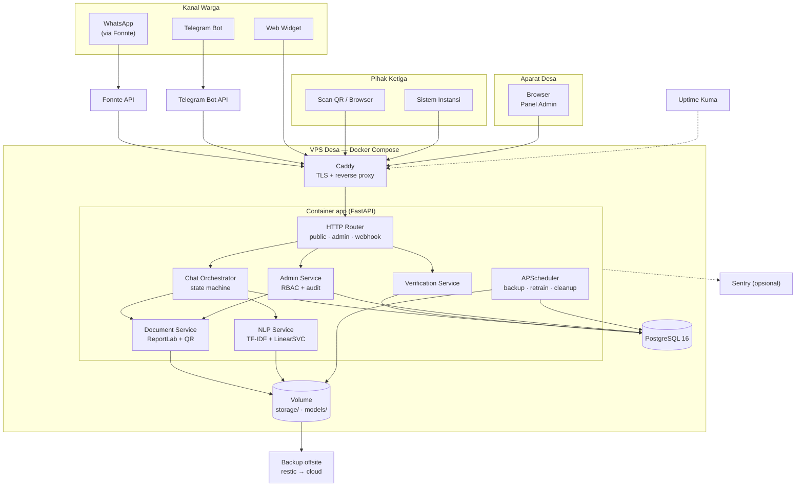
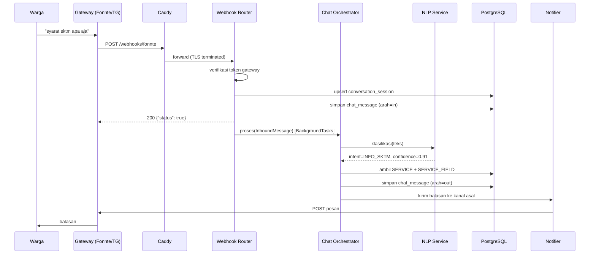
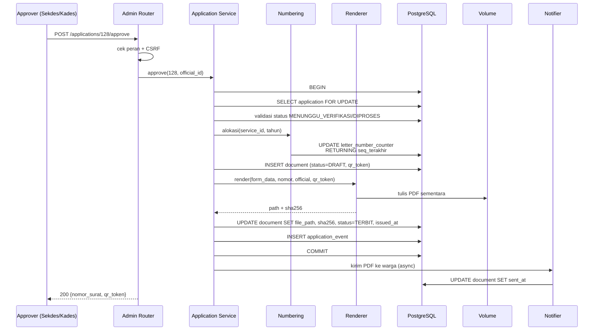
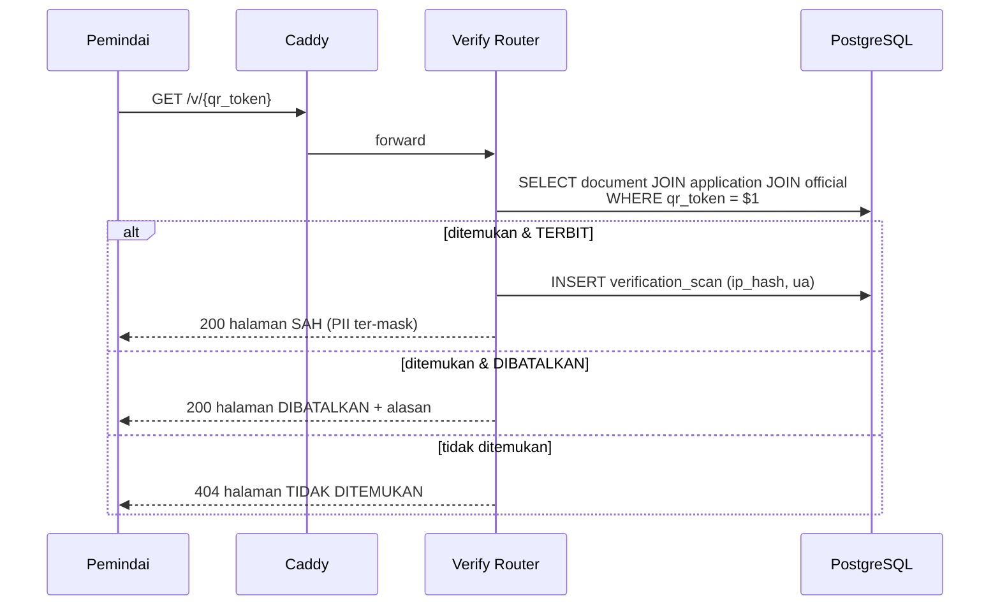
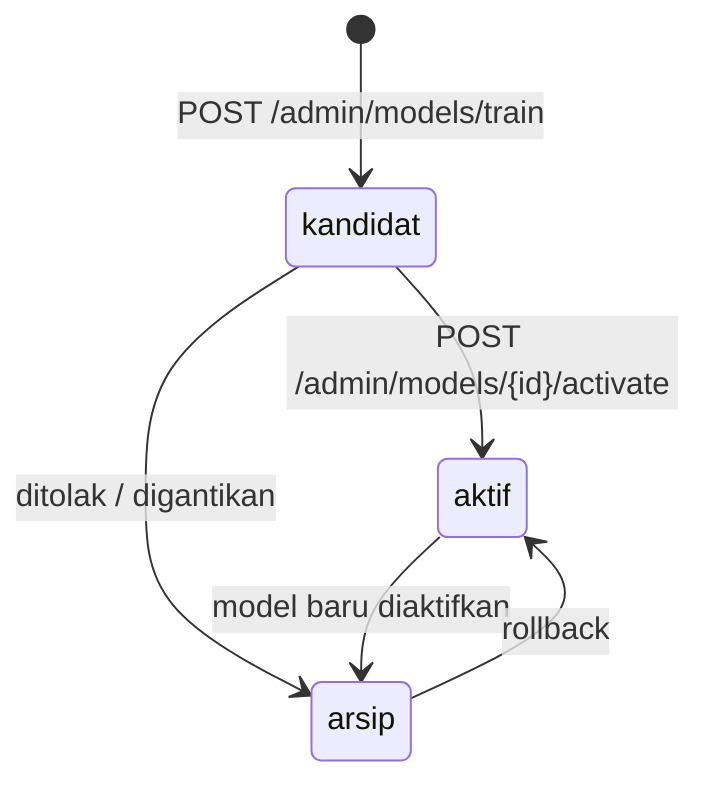
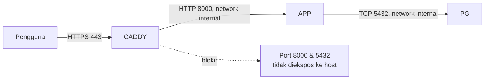

# ARCHITECTURE.md: SILADESA

## System Overview

SILADESA adalah **monolit modular Python** yang di-deploy sebagai satu container aplikasi. Tidak ada message broker, tidak ada SPA terpisah, dan tidak ada layanan ML eksternal. Semua komponen berjalan dalam satu proses Uvicorn, dengan PostgreSQL sebagai satu-satunya penyimpanan state.



**Prinsip desain:**

1. **Satu proses, satu database.** Setiap penambahan komponen harus dibenarkan oleh kebutuhan nyata pada skala satu desa (< 1.000 pesan/hari).
2. **Konfigurasi di database, bukan di kode.** Layanan, field, template, jam layanan, dan ambang keyakinan dapat diubah admin tanpa deploy.
3. **Semua keputusan yang tidak pasti diarahkan ke manusia.** Model NLP yang ragu meminta klarifikasi atau eskalasi, tidak menebak.
4. **Dokumen adalah artefak yang dapat diaudit.** Setiap PDF punya nomor, hash, token verifikasi, dan jejak aktor.
5. **Gagal dengan aman.** Kegagalan generate PDF tidak boleh menghasilkan dokumen setengah jadi atau status `TERBIT` palsu.

## Component Architecture

### Lapisan aplikasi

```text
app/
├── main.py                  # factory FastAPI, middleware, router registration
├── config.py                # Settings (pydantic-settings) dari .env
├── db.py                    # engine, session factory, dependency get_db
├── models/                  # SQLAlchemy 2.0 models (22 tabel)
│   ├── admin.py
│   ├── citizen.py
│   ├── service.py
│   ├── application.py
│   ├── document.py
│   ├── nlp.py
│   └── system.py
├── schemas/                 # Pydantic v2 request/response
├── repositories/            # kueri database, tanpa logika bisnis
├── services/
│   ├── chat/
│   │   ├── orchestrator.py  # state machine percakapan
│   │   ├── states.py        # IDLE, MENU, INFO, SLOT_FILLING, KONFIRMASI, ESKALASI
│   │   ├── slot_filling.py  # pengumpulan & validasi field
│   │   └── responses.py     # template balasan bahasa Indonesia
│   ├── nlp/
│   │   ├── preprocess.py    # normalisasi, tokenisasi, stemming Sastrawi
│   │   ├── classifier.py    # load artefak, predict, confidence
│   │   ├── trainer.py       # latih, evaluasi, simpan artefak
│   │   └── lexicon.py       # kamus singkatan & dialek lokal
│   ├── documents/
│   │   ├── numbering.py     # alokasi nomor atomik
│   │   ├── renderer.py      # ReportLab platypus
│   │   ├── qr.py            # generate QR + token
│   │   └── signing.py       # tempel TTD + watermark
│   ├── verification.py
│   ├── notifications.py     # kirim balasan ke kanal asal
│   └── audit.py
├── channels/
│   ├── base.py              # protokol ChannelAdapter
│   ├── whatsapp.py          # Fonnte
│   ├── telegram.py          # python-telegram-bot
│   └── web.py               # web widget
├── routers/
│   ├── public.py
│   ├── admin.py
│   ├── webhooks.py
│   └── verify.py
├── templates/               # Jinja2: admin/, verify/, widget/
├── static/                  # Tailwind build, JS, ikon
└── seed.py                  # seed idempoten
```

### Batas modul

| Modul | Tanggung jawab | Tidak boleh |
|:---|:---|:---|
| `channels/*` | Normalisasi payload kanal → `InboundMessage`; kirim `OutboundMessage` | Mengakses database atau memanggil classifier langsung |
| `services/chat` | Menentukan langkah berikutnya berdasarkan state dan hasil klasifikasi | Merender PDF atau menulis langsung ke tabel `document` |
| `services/nlp` | Teks → intent + confidence | Menyentuh tabel aplikasi atau mengirim pesan |
| `services/documents` | Data tervalidasi → PDF + nomor + QR + hash | Mengubah status pengajuan |
| `services/verification` | Token → status keabsahan | Mengembalikan PII lengkap |
| `repositories` | Kueri SQL | Logika bisnis atau panggilan HTTP |
| `routers` | Validasi request, otorisasi, pemetaan response | Kueri SQL langsung |

Aturan ini ditegakkan lewat review dan `ruff` (import lintar-modul dilarang untuk `channels → repositories`).

## Technology Stack Details

| Layer | Teknologi | Versi | Catatan operasional |
|:---|:---|:---|:---|
| Runtime | Python | 3.12 | Satu interpreter untuk web, NLP, dan PDF |
| ASGI server | Uvicorn | 0.32 | 2 worker, `--proxy-headers` |
| Web framework | FastAPI | 0.115 | OpenAPI otomatis di `/docs` (dinonaktifkan di produksi) |
| Validasi | Pydantic | 2.9 | Skema request/response |
| ORM | SQLAlchemy | 2.0 | `selectinload` untuk relasi |
| Migrasi | Alembic | 1.13 | Satu revisi per perubahan skema |
| Database | PostgreSQL | 16 | SQLite untuk dev/test |
| Template | Jinja2 | 3.1 | Server-rendered |
| Interaksi | HTMX 2 + Alpine.js 3 | — | Tanpa build step JS |
| CSS | Tailwind CSS 3 | standalone CLI | Dikompilasi saat build image |
| PDF | ReportLab | 4.2 | Platypus, font Times |
| QR | qrcode + Pillow | 8.0 | PNG 300 dpi |
| NLP | scikit-learn | 1.5 | TF-IDF + LinearSVC terkalibrasi |
| Stemming | Sastrawi | 1.0.1 | Bahasa Indonesia |
| Fuzzy | rapidfuzz | 3.10 | Fallback pencocokan nama layanan |
| Telegram | python-telegram-bot | 21 | Webhook mode |
| WhatsApp | Fonnte HTTP API | — | Adapter di `channels/whatsapp.py` |
| Scheduler | APScheduler | 3.10 | In-process, `AsyncIOScheduler` |
| Logging | loguru | 0.7 | JSON sink ke stdout |
| Proxy | Caddy | 2.8 | TLS otomatis |
| Container | Docker + Compose | 27 / v2 | Tiga service |

## Request Flow

### 1. Pesan masuk dari WhatsApp/Telegram



Webhook **selalu** membalas 200 lebih dulu, lalu memproses di background. Ini mencegah gateway mengulang pengiriman ketika pemrosesan lambat, dan menjaga latensi webhook di bawah 200 ms.

### 2. Web widget (sinkron)

Widget memakai `POST /api/v1/chat/messages` yang memproses secara sinkron dengan batas waktu 5 detik. Bila NLP gagal, respons tetap 200 dengan `state: "ESKALASI"` agar percakapan tidak macet.

### 3. Pembuatan dokumen



**Urutan kritis:** nomor dialokasikan **di dalam transaksi yang sama** dengan pembuatan baris `document`. Bila render gagal, transaksi di-rollback dan counter ikut kembali — tidak ada nomor yang "hilang".

### 4. Verifikasi QR



Endpoint verifikasi tidak pernah menyentuh `citizen.alamat` lengkap dan tidak menyajikan PDF.

## NLP Subsystem

### Pipeline

```text
Teks mentah
  → case folding
  → hapus karakter non-alfanumerik (pertahankan spasi & tanda hubung)
  → normalisasi kamus (sktm → surat keterangan tidak mampu, gak/ga → tidak, ...)
  → tokenisasi
  → stopword removal (daftar Sastrawi + tambahan lokal)
  → stemming Sastrawi
  → TF-IDF (word 1–2 gram + char_wb 3–5 gram)
  → LinearSVC (calibrated) → decision scores
  → softmax → intent + confidence + top-3
```

### Mengapa TF-IDF + LinearSVC

| Aspek | TF-IDF + LinearSVC | IndoBERT |
|:---|:---|:---|
| Ukuran artefak | < 5 MB | 400–500 MB |
| RAM inferensi | < 200 MB | ≥ 1,5 GB |
| Latensi | < 20 ms | 80–200 ms (CPU) |
| Data minimum | ~40–60 ujaran/kelas | ~500+/kelas untuk fine-tuning layak |
| Waktu latih | < 10 detik | 30–90 menit (CPU) |
| Kebutuhan GPU | Tidak | Sangat disarankan |
| Keterjelasan | Bobot fitur dapat diperiksa | Sulit dijelaskan |

Untuk domain tertutup dengan 18 intent dan dataset skripsi berskala ratusan, model linear adalah pilihan yang dapat dipertanggungjawabkan dan dapat dijelaskan di sidang. IndoBERT dicatat sebagai pengembangan lanjutan pada fase 2.

### Kalibrasi keyakinan

`LinearSVC` tidak menghasilkan probabilitas, sehingga dibungkus `CalibratedClassifierCV(method="sigmoid", cv=5)`. Ambang keputusan memakai probabilitas terkalibrasi:

| Rentang `confidence` | Aksi |
|:---|:---|
| ≥ 0,65 | Jawab langsung |
| 0,40 – 0,65 | Minta klarifikasi (maks 3 pilihan) |
| < 0,40 | Tawarkan eskalasi ke petugas |

Nilai ambang disimpan pada tabel `setting` sehingga dapat disesuaikan tanpa deploy.

### Siklus hidup model



*   Artefak disimpan di `models/{versi}/model.joblib` beserta `preprocessor.joblib` dan `metadata.json`.
*   Hanya satu model `aktif` (partial unique index `uq_model_aktif`).
*   Aplikasi memuat model aktif saat startup dan menyimpan referensi di memori; aktivasi model baru memicu reload tanpa restart proses.
*   Retrain otomatis berjalan bulanan (APScheduler) tetapi **tidak pernah** mengaktifkan model sendiri — aktivasi selalu manual oleh Admin Teknis.

### Penanganan pertanyaan gagal

```text
confidence < 0,40
  → simpan ke unanswered (via chat_message + flag)
  → tampilkan eskalasi ke warga
  → masuk antrean pelabelan admin
  → dilabeli → training_sample(sumber=chat_log)
  → retrain manual → evaluasi → aktivasi
```

## Data Architecture

*   **Sumber kebenaran:** PostgreSQL 16. Tidak ada cache terpisah; kueri desa cukup cepat dengan indeks yang ada.
*   **Berkas:** volume Docker `storage/` berisi `documents/{tahun}/{bulan}/{ticket}.pdf`, `officials/ttd_*.png`, `attachments/{application_id}/*`, dan `models/{versi}/*`. Path relatif disimpan di database.
*   **Snapshot vs referensi:** `application.form_data` adalah snapshot JSONB saat submit. Perubahan `citizen` setelahnya tidak mengubah dokumen yang sudah terbit — penting untuk integritas arsip.
*   **Append-only:** `application_event`, `audit_log`, `verification_scan` hanya menerima `INSERT`. Hak `DELETE` dicabut dari user database aplikasi.
*   **Retensi:** lihat DATABASE.md § Security & Compliance.
*   **Backup:** `pg_dump` + `restic` untuk volume, harian 02.00 WITA.

## Security Architecture



| Kontrol | Implementasi |
|:---|:---|
| Transport | TLS 1.2+ via Caddy, HSTS 1 tahun, redirect 80→443 |
| Autentikasi admin | Argon2id (`time_cost=3, memory_cost=64MB, parallelism=4`), lockout 5 gagal/15 menit |
| Sesi | Cookie `HttpOnly; Secure; SameSite=Lax`, ID acak 256 bit, server-side store |
| CSRF | Token per sesi pada header `X-CSRF-Token` untuk semua `POST/PATCH/DELETE` admin |
| Otorisasi | Dekorator `require_role(...)` pada setiap route admin; diuji dengan matriks peran |
| XSS | Autoescape Jinja2; CSP `default-src 'self'`; tidak ada `innerHTML` dari input pengguna |
| SQLi | SQLAlchemy parameterized query; tidak ada string SQL yang disusun manual |
| Unggahan berkas | Validasi MIME + ekstensi + ukuran (maks 5 MB); disimpan di luar webroot; nama file diacak |
| Rate limit | SlowAPI: login 5/menit/IP, chat 20/menit/sesi, verifikasi 60/menit/IP |
| Secret | `.env` dengan izin 600, tidak masuk git; rotasi kredensial terdokumentasi |
| PII | NIK di-mask di semua respons publik; log tidak memuat NIK/nama; IP di-hash dengan salt |
| Audit | `audit_log` append-only untuk seluruh aksi admin dan transisi status |
| Container | Proses non-root, read-only root filesystem kecuali `storage/`, tanpa `--privileged` |
| Host | UFW hanya 22/80/443, `fail2ban` untuk SSH, login SSH memakai kunci |

**Ancaman utama dan penanganannya:**

| Ancaman | Mitigasi |
|:---|:---|
| Pemalsuan surat | QR + hash SHA-256 + halaman verifikasi resmi |
| Penyalahgunaan akun operator | RBAC, audit log, tidak ada hak terbit untuk operator |
| Pencurian scan TTD | Akses terbatas, audit unduhan, watermark hanya pada dokumen sah |
| Enumerasi tiket | `ticket_no` butuh sesi pemilik; `qr_token` 128 bit acak |
| Kebocoran dataset warga | Anonimisasi sebelum masuk `training_sample` |
| DoS pada webhook | Rate limit + pemrosesan background + batas ukuran body 64 KB |

## Deployment Architecture

```text
Internet
   │
   ▼
┌──────────────────────────────────────────────┐
│ VPS 2 vCPU / 2 GB / 40 GB — Ubuntu 24.04     │
│                                              │
│  Caddy :80,:443  ──►  app :8000 (2 worker)   │
│                        │                     │
│                        └──► postgres :5432   │
│                                              │
│  volume: pgdata/  storage/  models/          │
└──────────────────────────────────────────────┘
   │
   └──► restic → penyimpanan offsite (harian)
```

Detail perintah, `docker-compose.yml`, `Caddyfile`, CI, backup, dan runbook ada di DEPLOYMENT.md.

## Performance & Scalability

| Skenario | Beban | Kapasitas | Bottleneck | Tindakan |
|:---|:---|:---|:---|:---|
| Normal | 200 pesan/hari, 20 pengajuan/hari | < 5% CPU | — | — |
| Puncak | 1.000 pesan/hari, 50 concurrent | ~25% CPU, ~700 MB RAM | Render PDF | 2 worker + antrean background |
| Ekstrem | 5.000 pesan/hari | ~60% CPU | PostgreSQL write | Naikkan VPS ke 4 GB, tambah worker |
| Lonjakan | 100 pesan/menit | Antrean background > 1 menit | Satu proses | Pisahkan worker background ke proses kedua |

**Optimasi yang sudah diterapkan:**

*   Model NLP dimuat sekali saat startup, bukan per request.
*   Koneksi database di-pool (5 + 5 overflow).
*   PDF dirender di background task untuk kanal chat; hanya panel admin yang menunggu sinkron.
*   Aset statis disajikan Caddy langsung, bukan lewat Python.
*   `selectinload` mencegah N+1 pada daftar pengajuan.

**Batas yang diakui:** aplikasi ini tidak dirancang untuk multi-desa. Bila dibutuhkan, jalur evolusi adalah menambahkan `village_id` pada tabel inti dan memisahkan database per desa — bukan menambah orkestrasi.

## Observability & Error Handling

| Aspek | Implementasi |
|:---|:---|
| Log | loguru JSON ke stdout: `{time, level, event, request_id, session_id, duration_ms}`. Tanpa NIK/nama. |
| Request ID | Middleware menghasilkan `X-Request-ID`, diteruskan ke log dan response error. |
| Error tracking | Sentry SDK (opsional, DSN dari env); `before_send` menghapus field PII. |
| Health check | `/healthz` memeriksa DB (`SELECT 1`) dan keberadaan model aktif. |
| Uptime | Uptime Kuma memantau `/healthz` tiap 60 detik + notifikasi Telegram. |
| Metrik ringan | Endpoint `/internal/metrics` (basic auth) mengembalikan hitungan pesan, pengajuan, error 5 menit terakhir. |
| Retry | Notifikasi kanal: 3 percobaan, backoff 2/8/30 detik; kegagalan akhir dicatat + tautan unduhan 7 hari. |
| Circuit breaker | Adapter kanal menandai gateway tidak sehat setelah 5 kegagalan berurutan dalam 2 menit; pesan diantrekan. |

**Strategi kegagalan:**

| Kegagalan | Perilaku sistem |
|:---|:---|
| Model NLP tidak termuat | `/healthz` 503; chat membalas "layanan sedang dalam pemeliharaan" dan membuat tiket eskalasi |
| PostgreSQL tidak tersedia | 503 pada semua endpoint; webhook tetap 200 agar gateway tidak membanjiri |
| Fonnte tidak tersedia | Pesan tetap disimpan; percobaan ulang; web widget & Telegram tetap jalan |
| Render PDF gagal | Status tetap `DIPROSES`, nomor di-rollback, error dicatat dengan `ticket_no` |
| Disk penuh | `/healthz` 503; scheduler menghapus PDF sementara > 30 hari; alert |

## Development Workflow

```bash
# 1. Setup
python -m venv .venv && source .venv/bin/activate
pip install -r requirements-dev.txt
cp .env.example .env

# 2. Database lokal (SQLite otomatis)
alembic upgrade head
python -m app.seed

# 3. Tailwind (sekali saat mengubah kelas)
tailwindcss -i app/static/css/input.css -o app/static/css/app.css --minify

# 4. Jalankan
uvicorn app.main:app --reload

# 5. Kualitas
ruff check . && ruff format --check .
pytest -q --cov=app --cov-report=term-missing
```

**Branch & rilis:** `main` selalu dapat di-deploy; fitur di branch `feat/*`; tag `v1.0.0` memicu build image dan deploy manual ke VPS.

**Definition of done per fitur:** ada test, ada entri audit bila mengubah data, ada pembaruan dokumentasi API bila menambah endpoint, dan `ruff` bersih.

## Architecture Decision Records

### ADR-001: Monolit Python, bukan microservice

**Konteks:** Satu developer, satu VPS 2 GB, kebutuhan NLP + web + PDF.
**Keputusan:** Satu aplikasi FastAPI dengan modul terpisah secara internal.
**Konsekuensi:** Deploy sederhana dan debugging mudah; batas modul harus disiplin agar tidak menjadi "big ball of mud". Ekstraksi layanan hanya bila ada kebutuhan skalabilitas nyata.

### ADR-002: Server-rendered + HTMX, bukan SPA

**Konteks:** Panel admin dipakai 2–3 orang dengan perangkat kelas menengah.
**Keputusan:** Jinja2 + HTMX + Alpine.js, Tailwind dikompilasi via CLI.
**Konsekuensi:** Tidak ada build JS, tidak ada duplikasi validasi, waktu muat lebih baik di jaringan lambat. Interaksi sangat kompleks (drag-and-drop editor) tidak akan semulus SPA.

### ADR-003: SQLite untuk dev, PostgreSQL untuk produksi

**Konteks:** Butuh transaksi dan penguncian baris untuk nomor surat.
**Keputusan:** Dua dialek, satu model SQLAlchemy.
**Konsekuensi:** Pengembangan tanpa setup; produksi aman untuk penulisan bersamaan. Perbedaan tipe (JSONB vs JSON, ENUM vs CHECK) diisolasi di migrasi dan diuji di CI dengan PostgreSQL.

### ADR-004: TF-IDF + LinearSVC, bukan IndoBERT

**Konteks:** Dataset ratusan ujaran, VPS 2 GB tanpa GPU, target akurasi 85%.
**Keputusan:** Model linear terkalibrasi dengan TF-IDF word+char n-gram.
**Konsekuensi:** Latih < 10 detik, inferensi < 20 ms, artefak < 5 MB, dapat dijelaskan. Akurasi pada parafrase sangat jauh mungkin tertinggal dari transformer; dimitigasi dengan kamus normalisasi dan mekanisme klarifikasi.

### ADR-005: Fonnte sebagai gateway WhatsApp

**Konteks:** WhatsApp Cloud API resmi memerlukan verifikasi bisnis Meta dan nomor khusus.
**Keputusan:** Fonnte sebagai transport, di balik antarmuka `ChannelAdapter`.
**Konsekuensi:** Cepat dipakai dan murah; ketergantungan pada pihak ketiga. Penggantian penyedia hanya menyentuh satu berkas adapter.

### ADR-006: Nomor surat dialokasikan dalam transaksi penerbitan

**Konteks:** Dua operator dapat menyetujui bersamaan.
**Keputusan:** `SELECT ... FOR UPDATE` pada `letter_number_counter` di dalam transaksi yang sama dengan `INSERT document`.
**Konsekuensi:** Tidak ada nomor duplikat maupun nomor hilang saat render gagal. Biaya: satu baris terkunci selama render (< 5 detik), dapat diterima pada skala desa.

### ADR-007: Tanpa Redis/Celery

**Konteks:** < 1.000 pesan/hari, satu mesin.
**Keputusan:** `BackgroundTasks` + APScheduler in-process.
**Konsekuensi:** Tiga komponen lebih sedikit untuk dioperasikan. Pekerjaan hilang bila proses restart di tengah tugas; dimitigasi dengan idempotensi dan status `DIPROSES` yang dapat diproses ulang manual.
