# DATABASE.md: SILADESA

## Entity Relationship Diagram

```mermaid
erDiagram
    ADMIN_USER ||--o{ AUDIT_LOG : "menghasilkan"
    ADMIN_USER ||--o{ APPLICATION : "meninjau"
    ADMIN_USER ||--o{ LETTER_TEMPLATE : "membuat"
    ADMIN_USER ||--o{ NLP_MODEL : "melatih"
    CITIZEN ||--o{ APPLICATION : "mengajukan"
    CITIZEN ||--o{ CONVERSATION_SESSION : "memiliki"
    CITIZEN ||--o{ FEEDBACK_RESPONSE : "memberi"
    SERVICE ||--o{ SERVICE_FIELD : "mendefinisikan"
    SERVICE ||--o{ LETTER_TEMPLATE : "memakai"
    SERVICE ||--o{ APPLICATION : "mengkategorikan"
    SERVICE ||--o{ LETTER_NUMBER_COUNTER : "memiliki"
    SERVICE ||--o{ FAQ : "menjelaskan"
    APPLICATION ||--o{ DOCUMENT : "menghasilkan"
    APPLICATION ||--o{ APPLICATION_EVENT : "mencatat"
    APPLICATION ||--o{ ATTACHMENT : "melampirkan"
    APPLICATION ||--o{ FEEDBACK_RESPONSE : "dinilai"
    APPLICATION ||--o{ CONVERSATION_SESSION : "dirujuk"
    DOCUMENT ||--o{ VERIFICATION_SCAN : "dipindai"
    OFFICIAL ||--o{ DOCUMENT : "menandatangani"
    INTENT ||--o{ TRAINING_SAMPLE : "berisi"
    NLP_MODEL ||--o{ MODEL_METRIC : "menghasilkan"
    CONVERSATION_SESSION ||--o{ CHAT_MESSAGE : "berisi"

    ADMIN_USER {
        bigint id PK
        varchar nama
        varchar email UK
        varchar password_hash
        varchar role
        boolean aktif
        boolean must_change_password
        smallint failed_login_count
        timestamptz locked_until
        timestamptz last_login_at
        timestamptz created_at
        timestamptz updated_at
    }

    CITIZEN {
        bigint id PK
        char nik UK
        char no_kk
        varchar nama_lengkap
        varchar tempat_lahir
        date tanggal_lahir
        varchar jenis_kelamin
        varchar agama
        varchar status_perkawinan
        varchar pekerjaan
        text alamat
        varchar dusun
        varchar no_hp
        timestamptz consent_at
        varchar consent_version
        timestamptz created_at
        timestamptz updated_at
    }

    SERVICE {
        serial id PK
        varchar kode UK
        varchar nama
        text deskripsi
        text persyaratan
        text alur
        smallint sla_hari
        numeric biaya
        smallint urutan
        boolean aktif
        smallint fase
        timestamptz created_at
        timestamptz updated_at
    }

    SERVICE_FIELD {
        serial id PK
        int service_id FK
        varchar nama_field
        varchar label
        varchar tipe
        boolean wajib
        smallint urutan
        jsonb opsi
        varchar validasi
        varchar placeholder
        timestamptz created_at
    }

    LETTER_TEMPLATE {
        serial id PK
        int service_id FK
        varchar nama
        smallint versi
        text konten_html
        boolean aktif
        bigint created_by FK
        timestamptz created_at
    }

    APPLICATION {
        bigint id PK
        varchar ticket_no UK
        bigint citizen_id FK
        int service_id FK
        varchar status
        jsonb form_data
        text catatan_pemohon
        text catatan_operator
        text rejected_reason
        bigint reviewed_by FK
        timestamptz reviewed_at
        bigint approved_by FK
        timestamptz approved_at
        timestamptz created_at
        timestamptz updated_at
    }

    APPLICATION_EVENT {
        bigint id PK
        bigint application_id FK
        varchar dari_status
        varchar ke_status
        bigint aktor_id FK
        varchar aktor_role
        text catatan
        timestamptz created_at
    }

    DOCUMENT {
        bigint id PK
        bigint application_id FK
        smallint versi
        varchar nomor_surat
        int seq
        smallint tahun
        varchar file_path
        int file_size
        char sha256
        varchar qr_token UK
        int official_id FK
        varchar status
        timestamptz issued_at
        timestamptz sent_at
        timestamptz revoked_at
        text revoked_reason
        timestamptz created_at
    }

    OFFICIAL {
        serial id PK
        varchar nama
        varchar jabatan
        varchar nip
        varchar ttd_path
        date berlaku_mulai
        date berlaku_sampai
        boolean aktif
        timestamptz created_at
        timestamptz updated_at
    }

    VERIFICATION_SCAN {
        bigint id PK
        bigint document_id FK
        char ip_hash
        varchar user_agent
        varchar referer
        timestamptz scanned_at
    }

    AUDIT_LOG {
        bigint id PK
        bigint admin_user_id FK
        varchar aksi
        varchar entitas
        bigint entitas_id
        jsonb perubahan
        char ip_hash
        timestamptz created_at
    }

    INTENT {
        serial id PK
        varchar kode UK
        varchar nama
        text deskripsi
        varchar jenis
        boolean aktif
        timestamptz created_at
    }

    FAQ {
        serial id PK
        int service_id FK
        varchar pertanyaan
        text jawaban
        varchar kategori
        smallint urutan
        boolean aktif
        bigint updated_by FK
        timestamptz created_at
        timestamptz updated_at
    }

    TRAINING_SAMPLE {
        bigint id PK
        int intent_id FK
        text teks
        text teks_normalisasi
        varchar sumber
        varchar split
        boolean aktif
        timestamptz created_at
    }

    NLP_MODEL {
        serial id PK
        varchar versi UK
        varchar algoritma
        varchar path
        numeric akurasi
        numeric macro_f1
        int jumlah_train
        int jumlah_test
        varchar status
        text catatan
        bigint dilatih_oleh FK
        timestamptz created_at
    }

    MODEL_METRIC {
        serial id PK
        int nlp_model_id FK
        varchar intent_kode
        numeric precision
        numeric recall
        numeric f1
        int support
        timestamptz created_at
    }

    CONVERSATION_SESSION {
        bigint id PK
        varchar channel
        varchar external_user_id
        bigint citizen_id FK
        varchar state
        varchar intent_aktif
        jsonb slot_data
        bigint application_id FK
        timestamptz last_activity_at
        timestamptz created_at
    }

    CHAT_MESSAGE {
        bigint id PK
        bigint session_id FK
        varchar arah
        text isi
        varchar intent_kode
        numeric confidence
        jsonb meta
        timestamptz created_at
    }

    FEEDBACK_RESPONSE {
        bigint id PK
        bigint application_id FK
        bigint citizen_id FK
        varchar instrumen
        smallint skor
        varchar komentar
        timestamptz created_at
    }

    ATTACHMENT {
        bigint id PK
        bigint application_id FK
        varchar file_path
        varchar original_filename
        varchar mime_type
        int file_size
        char sha256
        timestamptz created_at
    }

    LETTER_NUMBER_COUNTER {
        serial id PK
        int service_id FK
        smallint tahun
        int seq_terakhir
        timestamptz updated_at
    }

    SETTING {
        serial id PK
        varchar key UK
        text value
        varchar tipe
        timestamptz updated_at
    }
```



## Table Definitions

### ADMIN_USER

Menyimpan akun pengelola sistem. Satu akun memiliki tepat satu peran.

| Column | Type | Constraints | Description |
|:---|:---|:---|:---|
| id | BIGSERIAL | PK | Identifier unik |
| nama | VARCHAR(100) | NOT NULL | Nama lengkap pengguna |
| email | VARCHAR(150) | UK, NOT NULL | Email login |
| password_hash | VARCHAR(255) | NOT NULL | Hash Argon2id |
| role | VARCHAR(20) | NOT NULL, CHECK | `operator`, `sekdes`, `kepala_desa`, `admin_teknis` |
| aktif | BOOLEAN | DEFAULT TRUE | Status akun |
| must_change_password | BOOLEAN | DEFAULT FALSE | Wajib ganti password saat login |
| failed_login_count | SMALLINT | DEFAULT 0 | Penghitung percobaan gagal |
| locked_until | TIMESTAMPTZ | NULL | Waktu akhir penguncian akun |
| last_login_at | TIMESTAMPTZ | NULL | Login terakhir |
| created_at | TIMESTAMPTZ | DEFAULT now() | Waktu dibuat |
| updated_at | TIMESTAMPTZ | DEFAULT now() | Waktu diubah |

### CITIZEN

Menyimpan data pemohon. Satu NIK hanya boleh memiliki satu baris.

| Column | Type | Constraints | Description |
|:---|:---|:---|:---|
| id | BIGSERIAL | PK | Identifier unik |
| nik | CHAR(16) | UK, NOT NULL | NIK 16 digit |
| no_kk | CHAR(16) | NULL | Nomor Kartu Keluarga |
| nama_lengkap | VARCHAR(120) | NOT NULL | Nama sesuai KTP |
| tempat_lahir | VARCHAR(60) | NOT NULL | Tempat lahir |
| tanggal_lahir | DATE | NOT NULL | Tanggal lahir |
| jenis_kelamin | VARCHAR(10) | NOT NULL, CHECK | `Laki-Laki`, `Perempuan` |
| agama | VARCHAR(15) | NOT NULL, CHECK | Enumerasi enam agama |
| status_perkawinan | VARCHAR(20) | NOT NULL, CHECK | `Belum Kawin`, `Kawin`, `Cerai Hidup`, `Cerai Mati` |
| pekerjaan | VARCHAR(60) | NOT NULL | Pekerjaan |
| alamat | TEXT | NOT NULL | Alamat lengkap |
| dusun | VARCHAR(40) | NOT NULL | Nama dusun |
| no_hp | VARCHAR(15) | NOT NULL | Nomor HP aktif |
| consent_at | TIMESTAMPTZ | NULL | Waktu persetujuan pemrosesan data |
| consent_version | VARCHAR(10) | NULL | Versi kebijakan yang disetujui |
| created_at | TIMESTAMPTZ | DEFAULT now() | Waktu dibuat |
| updated_at | TIMESTAMPTZ | DEFAULT now() | Waktu diubah |

### SERVICE

Katalog layanan administrasi. Menjadi sumber jawaban chatbot dan dasar pembuatan pengajuan.

| Column | Type | Constraints | Description |
|:---|:---|:---|:---|
| id | SERIAL | PK | Identifier unik |
| kode | VARCHAR(10) | UK, NOT NULL | Kode layanan (`DOM`, `SKTM`, `USH`, `PGG`) |
| nama | VARCHAR(100) | NOT NULL | Nama layanan |
| deskripsi | TEXT | NULL | Ringkasan layanan |
| persyaratan | TEXT | NULL | Daftar persyaratan |
| alur | TEXT | NULL | Prosedur pengajuan |
| sla_hari | SMALLINT | DEFAULT 1 | Estimasi hari penyelesaian |
| biaya | NUMERIC(12,2) | DEFAULT 0 | Biaya layanan (0 = gratis) |
| urutan | SMALLINT | DEFAULT 0 | Urutan tampil pada menu |
| aktif | BOOLEAN | DEFAULT TRUE | Status tampil |
| fase | SMALLINT | DEFAULT 1 | 1 = MVP, 2 = fase lanjutan |
| created_at | TIMESTAMPTZ | DEFAULT now() | Waktu dibuat |
| updated_at | TIMESTAMPTZ | DEFAULT now() | Waktu diubah |

### SERVICE_FIELD

Skema field dinamis per layanan. Menentukan pertanyaan yang diajukan chatbot.

| Column | Type | Constraints | Description |
|:---|:---|:---|:---|
| id | SERIAL | PK | Identifier unik |
| service_id | INT | FK → SERVICE.id, NOT NULL | Layanan pemilik field |
| nama_field | VARCHAR(50) | NOT NULL | Nama teknis (`nama_usaha`) |
| label | VARCHAR(100) | NOT NULL | Label yang ditanyakan ke warga |
| tipe | VARCHAR(15) | NOT NULL, CHECK | `text`, `number`, `date`, `enum`, `textarea`, `phone` |
| wajib | BOOLEAN | DEFAULT TRUE | Wajib diisi |
| urutan | SMALLINT | DEFAULT 0 | Urutan pertanyaan |
| opsi | JSONB | NULL | Daftar opsi untuk tipe `enum` |
| validasi | VARCHAR(255) | NULL | Pola atau aturan tambahan |
| placeholder | VARCHAR(100) | NULL | Nama placeholder di template |
| created_at | TIMESTAMPTZ | DEFAULT now() | Waktu dibuat |

Unique: `(service_id, nama_field)`.

### LETTER_TEMPLATE

Template surat berversi. Hanya satu versi aktif per layanan.

| Column | Type | Constraints | Description |
|:---|:---|:---|:---|
| id | SERIAL | PK | Identifier unik |
| service_id | INT | FK → SERVICE.id, NOT NULL | Layanan terkait |
| nama | VARCHAR(100) | NOT NULL | Nama template |
| versi | SMALLINT | NOT NULL | Nomor versi |
| konten_html | TEXT | NOT NULL | Isi template dengan placeholder |
| aktif | BOOLEAN | DEFAULT FALSE | Versi aktif |
| created_by | BIGINT | FK → ADMIN_USER.id | Pembuat versi |
| created_at | TIMESTAMPTZ | DEFAULT now() | Waktu dibuat |

Unique: `(service_id, versi)`. Partial unique index untuk satu versi aktif per layanan.

### APPLICATION

Tiket pengajuan surat. Menyimpan snapshot data pemohon pada `form_data`.

| Column | Type | Constraints | Description |
|:---|:---|:---|:---|
| id | BIGSERIAL | PK | Identifier unik |
| ticket_no | VARCHAR(20) | UK, NOT NULL | `APP-2026-000123` |
| citizen_id | BIGINT | FK → CITIZEN.id, NOT NULL | Pemohon |
| service_id | INT | FK → SERVICE.id, NOT NULL | Layanan |
| status | VARCHAR(25) | NOT NULL, CHECK | `DRAFT`, `MENUNGGU_VERIFIKASI`, `DIPROSES`, `TERBIT`, `DITOLAK`, `DIBATALKAN` |
| form_data | JSONB | NOT NULL | Snapshot seluruh field pengajuan |
| catatan_pemohon | TEXT | NULL | Catatan dari warga |
| catatan_operator | TEXT | NULL | Catatan internal operator |
| rejected_reason | TEXT | NULL | Alasan penolakan |
| reviewed_by | BIGINT | FK → ADMIN_USER.id, NULL | Operator peninjau |
| reviewed_at | TIMESTAMPTZ | NULL | Waktu peninjauan |
| approved_by | BIGINT | FK → ADMIN_USER.id, NULL | Pejabat penyetuju |
| approved_at | TIMESTAMPTZ | NULL | Waktu persetujuan |
| created_at | TIMESTAMPTZ | DEFAULT now() | Waktu dibuat |
| updated_at | TIMESTAMPTZ | DEFAULT now() | Waktu diubah |

### APPLICATION_EVENT

Riwayat transisi status. Bersifat append-only.

| Column | Type | Constraints | Description |
|:---|:---|:---|:---|
| id | BIGSERIAL | PK | Identifier unik |
| application_id | BIGINT | FK → APPLICATION.id, NOT NULL | Pengajuan |
| dari_status | VARCHAR(25) | NULL | Status asal (NULL untuk pembuatan) |
| ke_status | VARCHAR(25) | NOT NULL | Status tujuan |
| aktor_id | BIGINT | FK → ADMIN_USER.id, NULL | Aktor (NULL bila sistem/warga) |
| aktor_role | VARCHAR(20) | NOT NULL | `warga`, `sistem`, `operator`, `sekdes`, `kepala_desa`, `admin_teknis` |
| catatan | TEXT | NULL | Catatan transisi |
| created_at | TIMESTAMPTZ | DEFAULT now() | Waktu kejadian |

### DOCUMENT

Arsip dokumen PDF yang dihasilkan.

| Column | Type | Constraints | Description |
|:---|:---|:---|:---|
| id | BIGSERIAL | PK | Identifier unik |
| application_id | BIGINT | FK → APPLICATION.id, NOT NULL | Pengajuan asal |
| versi | SMALLINT | DEFAULT 1 | Versi dokumen (untuk penerbitan ulang) |
| nomor_surat | VARCHAR(40) | NOT NULL | Nomor lengkap |
| seq | INT | NOT NULL | Nomor urut |
| tahun | SMALLINT | NOT NULL | Tahun surat |
| file_path | VARCHAR(255) | NOT NULL | Path relatif berkas PDF |
| file_size | INT | NULL | Ukuran berkas (byte) |
| sha256 | CHAR(64) | NOT NULL | Hash berkas final |
| qr_token | VARCHAR(40) | UK, NOT NULL | Token verifikasi |
| official_id | INT | FK → OFFICIAL.id, NOT NULL | Pejabat penandatangan |
| status | VARCHAR(15) | NOT NULL, CHECK | `DRAFT`, `TERBIT`, `DIBATALKAN` |
| issued_at | TIMESTAMPTZ | NULL | Waktu terbit |
| sent_at | TIMESTAMPTZ | NULL | Waktu terkirim ke chat |
| revoked_at | TIMESTAMPTZ | NULL | Waktu pencabutan |
| revoked_reason | TEXT | NULL | Alasan pencabutan |
| created_at | TIMESTAMPTZ | DEFAULT now() | Waktu dibuat |

Unique: `(application_id, versi)`, `(tahun, seq)`.

### OFFICIAL

Pejabat penandatangan beserta berkas tanda tangan.

| Column | Type | Constraints | Description |
|:---|:---|:---|:---|
| id | SERIAL | PK | Identifier unik |
| nama | VARCHAR(100) | NOT NULL | Nama pejabat |
| jabatan | VARCHAR(60) | NOT NULL | Nama jabatan, dicocokkan ke pengaturan `penandatangan_<kode>` / `saksi_<kode>` |
| nip | VARCHAR(30) | NULL | NIP/NIAP |
| pangkat | VARCHAR(60) | NULL | Pangkat/golongan (opsional) |
| ttd_path | VARCHAR(255) | NULL | Path berkas scan TTD, relatif terhadap direktori penyimpanan |
| berlaku_sampai | DATE | NULL | Akhir masa berlaku; `NULL` berarti tanpa batas |
| aktif | BOOLEAN | DEFAULT TRUE | Status aktif |
| urutan | INTEGER | DEFAULT 0 | Urutan tampil pada panel |
| created_at | TIMESTAMPTZ | DEFAULT now() | Waktu dibuat |
| updated_at | TIMESTAMPTZ | DEFAULT now() | Waktu diubah |

Unique parsial: `(jabatan) WHERE aktif` — FR-41 mencegah dua pejabat aktif
pada jabatan yang sama. Pejabat dengan `berlaku_sampai` yang sudah lewat tidak
lagi dipakai sebagai penanda tangan, dan penggantinya otomatis dilepas
jabatannya saat didaftarkan.

### VERIFICATION_SCAN

Log pemindaian QR pada dokumen.

| Column | Type | Constraints | Description |
|:---|:---|:---|:---|
| id | BIGSERIAL | PK | Identifier unik |
| document_id | BIGINT | FK → DOCUMENT.id, NOT NULL | Dokumen yang dipindai |
| ip_hash | CHAR(64) | NOT NULL | SHA-256 IP + salt |
| user_agent | VARCHAR(255) | NULL | User agent pemindai |
| referer | VARCHAR(255) | NULL | Halaman asal |
| scanned_at | TIMESTAMPTZ | DEFAULT now() | Waktu pemindaian |

### AUDIT_LOG

Jejak aksi admin. Append-only.

| Column | Type | Constraints | Description |
|:---|:---|:---|:---|
| id | BIGSERIAL | PK | Identifier unik |
| admin_user_id | BIGINT | FK → ADMIN_USER.id, NULL | Aktor |
| aksi | VARCHAR(50) | NOT NULL | `create`, `update`, `delete`, `approve`, `reject`, `login` |
| entitas | VARCHAR(50) | NOT NULL | Nama tabel yang disentuh |
| entitas_id | BIGINT | NULL | ID baris yang disentuh |
| perubahan | JSONB | NULL | `{"field": {"lama": ..., "baru": ...}}` |
| ip_hash | CHAR(64) | NULL | SHA-256 IP + salt |
| created_at | TIMESTAMPTZ | DEFAULT now() | Waktu kejadian |

### INTENT

Label intent yang dikenali model NLP.

| Column | Type | Constraints | Description |
|:---|:---|:---|:---|
| id | SERIAL | PK | Identifier unik |
| kode | VARCHAR(40) | UK, NOT NULL | `INFO_DOMISILI`, `AJUKAN_SKTM` |
| nama | VARCHAR(100) | NOT NULL | Nama tampilan |
| deskripsi | TEXT | NULL | Penjelasan cakupan intent |
| jenis | VARCHAR(15) | NOT NULL, CHECK | `info`, `ajukan`, `faq`, `sistem` |
| aktif | BOOLEAN | DEFAULT TRUE | Status aktif |
| created_at | TIMESTAMPTZ | DEFAULT now() | Waktu dibuat |

### FAQ

Basis pengetahuan pertanyaan umum yang tidak memerlukan pengajuan. Dipakai untuk menjawab pertanyaan operasional (jam layanan, biaya, lokasi) dan pertanyaan tentang layanan tertentu.

| Column | Type | Constraints | Description |
|:---|:---|:---|:---|
| id | SERIAL | PK | Identifier unik |
| service_id | INT | FK → SERVICE.id, NULL | NULL berarti FAQ umum, bukan milik layanan tertentu |
| pertanyaan | VARCHAR(255) | NOT NULL | Pertanyaan seperti yang biasa ditulis warga |
| jawaban | TEXT | NOT NULL | Jawaban resmi yang dikirim bot |
| kategori | VARCHAR(50) | NULL | `operasional`, `persyaratan`, `prosedur`, `biaya` |
| urutan | SMALLINT | DEFAULT 0 | Urutan tampil |
| aktif | BOOLEAN | DEFAULT TRUE | Hanya FAQ aktif yang dikirim ke widget |
| updated_by | BIGINT | FK → ADMIN_USER.id, NULL | Penyunting terakhir |
| created_at | TIMESTAMPTZ | DEFAULT now() | Waktu dibuat |
| updated_at | TIMESTAMPTZ | DEFAULT now() | Waktu diubah |

**Catatan:** FAQ dijawab oleh intent berjenis `faq`, yang memetakan teks warga ke baris FAQ ini. Bila `service_id` terisi, bot hanya menawarkan FAQ tersebut setelah warga menyebut layanan yang bersangkutan.

### TRAINING_SAMPLE

Dataset berlabel untuk pelatihan dan evaluasi model.

| Column | Type | Constraints | Description |
|:---|:---|:---|:---|
| id | BIGSERIAL | PK | Identifier unik |
| intent_id | INT | FK → INTENT.id, NOT NULL | Label intent |
| teks | TEXT | NOT NULL | Teks asli |
| teks_normalisasi | TEXT | NULL | Hasil preprocessing |
| sumber | VARCHAR(15) | NOT NULL, CHECK | `manual`, `chat_log`, `import` |
| split | VARCHAR(5) | NOT NULL, CHECK | `train`, `test` |
| aktif | BOOLEAN | DEFAULT TRUE | Ikut dipakai saat latih |
| created_at | TIMESTAMPTZ | DEFAULT now() | Waktu dibuat |

### NLP_MODEL

Versi model NLP beserta metrik utamanya.

| Column | Type | Constraints | Description |
|:---|:---|:---|:---|
| id | SERIAL | PK | Identifier unik |
| versi | VARCHAR(20) | UK, NOT NULL | `2026.11.1` |
| algoritma | VARCHAR(50) | NOT NULL | `tfidf_linearsvc` |
| path | VARCHAR(255) | NOT NULL | Path artefak joblib |
| akurasi | NUMERIC(5,4) | NULL | Akurasi hasil cross-validation |
| macro_f1 | NUMERIC(5,4) | NULL | Macro F1 |
| jumlah_train | INT | NULL | Jumlah sampel latih |
| jumlah_test | INT | NULL | Jumlah sampel uji |
| status | VARCHAR(10) | NOT NULL, CHECK | `kandidat`, `aktif`, `arsip` |
| catatan | TEXT | NULL | Alasan aktivasi/penolakan |
| dilatih_oleh | BIGINT | FK → ADMIN_USER.id, NULL | Pelatih |
| created_at | TIMESTAMPTZ | DEFAULT now() | Waktu pelatihan |

### MODEL_METRIC

Metrik per kelas untuk satu versi model.

| Column | Type | Constraints | Description |
|:---|:---|:---|:---|
| id | SERIAL | PK | Identifier unik |
| nlp_model_id | INT | FK → NLP_MODEL.id, NOT NULL | Model |
| intent_kode | VARCHAR(40) | NOT NULL | Kode intent |
| precision | NUMERIC(5,4) | NOT NULL | Precision |
| recall | NUMERIC(5,4) | NOT NULL | Recall |
| f1 | NUMERIC(5,4) | NOT NULL | F1-score |
| support | INT | NOT NULL | Jumlah sampel uji kelas tersebut |
| created_at | TIMESTAMPTZ | DEFAULT now() | Waktu dibuat |

### CONVERSATION_SESSION

Konteks percakapan per pengguna per kanal.

| Column | Type | Constraints | Description |
|:---|:---|:---|:---|
| id | BIGSERIAL | PK | Identifier unik |
| channel | VARCHAR(15) | NOT NULL, CHECK | `whatsapp`, `telegram`, `web` |
| external_user_id | VARCHAR(60) | NOT NULL | Nomor WA / Telegram ID / cookie |
| citizen_id | BIGINT | FK → CITIZEN.id, NULL | Pemohon terkait |
| state | VARCHAR(30) | NOT NULL | `IDLE`, `MENU`, `INFO`, `SLOT_FILLING`, `KONFIRMASI`, `ESKALASI` |
| intent_aktif | VARCHAR(40) | NULL | Intent yang sedang diproses |
| slot_data | JSONB | NULL | Field yang sudah terisi |
| application_id | BIGINT | FK → APPLICATION.id, NULL | Pengajuan dalam proses |
| last_activity_at | TIMESTAMPTZ | NOT NULL | Aktivitas terakhir |
| created_at | TIMESTAMPTZ | DEFAULT now() | Waktu dibuat |

### CHAT_MESSAGE

Riwayat pesan masuk dan keluar.

| Column | Type | Constraints | Description |
|:---|:---|:---|:---|
| id | BIGSERIAL | PK | Identifier unik |
| session_id | BIGINT | FK → CONVERSATION_SESSION.id, NOT NULL | Sesi |
| arah | VARCHAR(3) | NOT NULL, CHECK | `in`, `out` |
| isi | TEXT | NOT NULL | Isi pesan |
| intent_kode | VARCHAR(40) | NULL | Intent terdeteksi (untuk pesan masuk) |
| confidence | NUMERIC(5,4) | NULL | Keyakinan klasifikasi |
| meta | JSONB | NULL | Data kanal (message_id, tombol, dsb.) |
| created_at | TIMESTAMPTZ | DEFAULT now() | Waktu pesan |

**Antrean pertanyaan gagal** tidak disimpan pada tabel tersendiri. Antrean diturunkan dari kueri berikut, sehingga tidak ada duplikasi data dan pelabelan dapat menandai baris aslinya:

```sql
SELECT id, isi, confidence, created_at
FROM chat_message
WHERE arah = 'in'
  AND (intent_kode IS NULL OR confidence < 0.40)
ORDER BY created_at DESC;
```

Setelah dilabeli, baris ditautkan ke `training_sample` melalui `meta.training_sample_id`. Baris yang sudah ditautkan tidak lagi muncul di antrean.

### FEEDBACK_RESPONSE

Umpan balik kepuasan pengguna.

| Column | Type | Constraints | Description |
|:---|:---|:---|:---|
| id | BIGSERIAL | PK | Identifier unik |
| application_id | BIGINT | FK → APPLICATION.id, NULL | Pengajuan terkait |
| citizen_id | BIGINT | FK → CITIZEN.id, NULL | Pemberi umpan balik |
| instrumen | VARCHAR(10) | NOT NULL, CHECK | `likert`, `sus` |
| skor | SMALLINT | NOT NULL, CHECK (1–5) | Nilai |
| komentar | VARCHAR(500) | NULL | Komentar bebas |
| created_at | TIMESTAMPTZ | DEFAULT now() | Waktu dibuat |

### ATTACHMENT

Berkas pendukung yang diunggah pemohon.

| Column | Type | Constraints | Description |
|:---|:---|:---|:---|
| id | BIGSERIAL | PK | Identifier unik |
| application_id | BIGINT | FK → APPLICATION.id, NOT NULL | Pengajuan |
| file_path | VARCHAR(255) | NOT NULL | Path penyimpanan |
| original_filename | VARCHAR(150) | NOT NULL | Nama asli berkas |
| mime_type | VARCHAR(60) | NOT NULL | `image/jpeg`, `image/png`, `application/pdf` |
| file_size | INT | NOT NULL | Ukuran (byte), maks 5 MB |
| sha256 | CHAR(64) | NOT NULL | Hash berkas |
| created_at | TIMESTAMPTZ | DEFAULT now() | Waktu unggah |

### LETTER_NUMBER_COUNTER

Counter nomor surat per layanan per tahun.

| Column | Type | Constraints | Description |
|:---|:---|:---|:---|
| id | SERIAL | PK | Identifier unik |
| service_id | INT | FK → SERVICE.id, NOT NULL | Layanan |
| tahun | SMALLINT | NOT NULL | Tahun |
| seq_terakhir | INT | DEFAULT 0 | Nomor terakhir terpakai |
| updated_at | TIMESTAMPTZ | DEFAULT now() | Waktu pembaruan |

Unique: `(service_id, tahun)`.

### SETTING

Konfigurasi sistem berbentuk key-value.

| Column | Type | Constraints | Description |
|:---|:---|:---|:---|
| id | SERIAL | PK | Identifier unik |
| key | VARCHAR(60) | UK, NOT NULL | Nama konfigurasi |
| value | TEXT | NULL | Nilai (disimpan sebagai teks) |
| tipe | VARCHAR(10) | NOT NULL | `string`, `int`, `bool`, `json`, `time` |
| updated_at | TIMESTAMPTZ | DEFAULT now() | Waktu diubah |

## Schema (PostgreSQL DDL)

```sql
-- =========================================================
-- SILADESA — Skema PostgreSQL 16
-- =========================================================

CREATE TYPE admin_role AS ENUM ('operator', 'sekdes', 'kepala_desa', 'admin_teknis');
CREATE TYPE application_status AS ENUM (
    'DRAFT', 'MENUNGGU_VERIFIKASI', 'DIPROSES', 'TERBIT', 'DITOLAK', 'DIBATALKAN'
);
CREATE TYPE document_status AS ENUM ('DRAFT', 'TERBIT', 'DIBATALKAN');
CREATE TYPE model_status AS ENUM ('kandidat', 'aktif', 'arsip');
CREATE TYPE field_type AS ENUM ('text', 'number', 'date', 'enum', 'textarea', 'phone');
CREATE TYPE channel_type AS ENUM ('whatsapp', 'telegram', 'web');

CREATE TABLE admin_user (
    id                  BIGSERIAL PRIMARY KEY,
    nama                VARCHAR(100) NOT NULL,
    email               VARCHAR(150) NOT NULL UNIQUE,
    password_hash       VARCHAR(255) NOT NULL,
    role                admin_role   NOT NULL,
    aktif               BOOLEAN      NOT NULL DEFAULT TRUE,
    must_change_password BOOLEAN     NOT NULL DEFAULT FALSE,
    failed_login_count  SMALLINT     NOT NULL DEFAULT 0,
    locked_until        TIMESTAMPTZ,
    last_login_at       TIMESTAMPTZ,
    created_at          TIMESTAMPTZ  NOT NULL DEFAULT now(),
    updated_at          TIMESTAMPTZ  NOT NULL DEFAULT now()
);

CREATE TABLE citizen (
    id                  BIGSERIAL PRIMARY KEY,
    nik                 CHAR(16)     NOT NULL UNIQUE,
    no_kk               CHAR(16),
    nama_lengkap        VARCHAR(120) NOT NULL,
    tempat_lahir        VARCHAR(60)  NOT NULL,
    tanggal_lahir       DATE         NOT NULL,
    jenis_kelamin       VARCHAR(10)  NOT NULL CHECK (jenis_kelamin IN ('Laki-Laki', 'Perempuan')),
    agama               VARCHAR(15)  NOT NULL CHECK (agama IN ('Islam', 'Kristen', 'Katolik', 'Hindu', 'Buddha', 'Konghucu')),
    status_perkawinan   VARCHAR(20)  NOT NULL CHECK (status_perkawinan IN ('Belum Kawin', 'Kawin', 'Cerai Hidup', 'Cerai Mati')),
    pekerjaan           VARCHAR(60)  NOT NULL,
    alamat              TEXT         NOT NULL,
    dusun               VARCHAR(40)  NOT NULL,
    no_hp               VARCHAR(15)  NOT NULL,
    consent_at          TIMESTAMPTZ,
    consent_version     VARCHAR(10),
    created_at          TIMESTAMPTZ  NOT NULL DEFAULT now(),
    updated_at          TIMESTAMPTZ  NOT NULL DEFAULT now()
);

CREATE TABLE service (
    id              SERIAL PRIMARY KEY,
    kode            VARCHAR(10)  NOT NULL UNIQUE,
    nama            VARCHAR(100) NOT NULL,
    deskripsi       TEXT,
    persyaratan     TEXT,
    alur            TEXT,
    sla_hari        SMALLINT     NOT NULL DEFAULT 1,
    biaya           NUMERIC(12,2) NOT NULL DEFAULT 0,
    urutan          SMALLINT     NOT NULL DEFAULT 0,
    aktif           BOOLEAN      NOT NULL DEFAULT TRUE,
    fase            SMALLINT     NOT NULL DEFAULT 1,
    created_at      TIMESTAMPTZ  NOT NULL DEFAULT now(),
    updated_at      TIMESTAMPTZ  NOT NULL DEFAULT now()
);

CREATE TABLE service_field (
    id              SERIAL PRIMARY KEY,
    service_id      INT          NOT NULL REFERENCES service(id) ON DELETE CASCADE,
    nama_field      VARCHAR(50)  NOT NULL,
    label           VARCHAR(100) NOT NULL,
    tipe            field_type   NOT NULL,
    wajib           BOOLEAN      NOT NULL DEFAULT TRUE,
    urutan          SMALLINT     NOT NULL DEFAULT 0,
    opsi            JSONB,
    validasi        VARCHAR(255),
    placeholder     VARCHAR(100),
    created_at      TIMESTAMPTZ  NOT NULL DEFAULT now(),
    UNIQUE (service_id, nama_field)
);

CREATE TABLE letter_template (
    id              SERIAL PRIMARY KEY,
    service_id      INT          NOT NULL REFERENCES service(id) ON DELETE CASCADE,
    nama            VARCHAR(100) NOT NULL,
    versi           SMALLINT     NOT NULL,
    konten_html     TEXT         NOT NULL,
    aktif           BOOLEAN      NOT NULL DEFAULT FALSE,
    created_by      BIGINT       REFERENCES admin_user(id),
    created_at      TIMESTAMPTZ  NOT NULL DEFAULT now(),
    UNIQUE (service_id, versi)
);

CREATE UNIQUE INDEX uq_template_aktif
    ON letter_template (service_id) WHERE aktif = TRUE;

CREATE TABLE application (
    id                  BIGSERIAL PRIMARY KEY,
    ticket_no           VARCHAR(20) NOT NULL UNIQUE,
    citizen_id          BIGINT      NOT NULL REFERENCES citizen(id),
    service_id          INT         NOT NULL REFERENCES service(id),
    status              application_status NOT NULL DEFAULT 'DRAFT',
    form_data           JSONB       NOT NULL,
    catatan_pemohon     TEXT,
    catatan_operator    TEXT,
    rejected_reason     TEXT,
    reviewed_by         BIGINT      REFERENCES admin_user(id),
    reviewed_at         TIMESTAMPTZ,
    approved_by         BIGINT      REFERENCES admin_user(id),
    approved_at         TIMESTAMPTZ,
    created_at          TIMESTAMPTZ NOT NULL DEFAULT now(),
    updated_at          TIMESTAMPTZ NOT NULL DEFAULT now()
);

CREATE TABLE application_event (
    id              BIGSERIAL PRIMARY KEY,
    application_id  BIGINT      NOT NULL REFERENCES application(id) ON DELETE CASCADE,
    dari_status     application_status,
    ke_status       application_status NOT NULL,
    aktor_id        BIGINT      REFERENCES admin_user(id),
    aktor_role      VARCHAR(20) NOT NULL,
    catatan         TEXT,
    created_at      TIMESTAMPTZ NOT NULL DEFAULT now()
);

CREATE TABLE official (
    id              SERIAL PRIMARY KEY,
    nama            VARCHAR(100) NOT NULL,
    jabatan         VARCHAR(40)  NOT NULL CHECK (jabatan IN ('kepala_desa', 'sekdes')),
    nip             VARCHAR(30),
    ttd_path        VARCHAR(255),
    berlaku_mulai   DATE         NOT NULL,
    berlaku_sampai  DATE,
    aktif           BOOLEAN      NOT NULL DEFAULT TRUE,
    created_at      TIMESTAMPTZ  NOT NULL DEFAULT now(),
    updated_at      TIMESTAMPTZ  NOT NULL DEFAULT now()
);

CREATE UNIQUE INDEX uq_official_aktif
    ON official (jabatan) WHERE aktif = TRUE;

CREATE TABLE document (
    id              BIGSERIAL PRIMARY KEY,
    application_id  BIGINT      NOT NULL REFERENCES application(id) ON DELETE CASCADE,
    versi           SMALLINT    NOT NULL DEFAULT 1,
    nomor_surat     VARCHAR(40) NOT NULL,
    seq             INT         NOT NULL,
    tahun           SMALLINT    NOT NULL,
    file_path       VARCHAR(255) NOT NULL,
    file_size       INT,
    sha256          CHAR(64)    NOT NULL,
    qr_token        VARCHAR(40) NOT NULL UNIQUE,
    official_id     INT         NOT NULL REFERENCES official(id),
    status          document_status NOT NULL DEFAULT 'DRAFT',
    issued_at       TIMESTAMPTZ,
    sent_at         TIMESTAMPTZ,
    revoked_at      TIMESTAMPTZ,
    revoked_reason  TEXT,
    created_at      TIMESTAMPTZ NOT NULL DEFAULT now(),
    UNIQUE (application_id, versi),
    UNIQUE (tahun, seq)
);

CREATE TABLE verification_scan (
    id              BIGSERIAL PRIMARY KEY,
    document_id     BIGINT      NOT NULL REFERENCES document(id) ON DELETE CASCADE,
    ip_hash         CHAR(64)    NOT NULL,
    user_agent      VARCHAR(255),
    referer         VARCHAR(255),
    scanned_at      TIMESTAMPTZ NOT NULL DEFAULT now()
);

CREATE TABLE audit_log (
    id              BIGSERIAL PRIMARY KEY,
    admin_user_id   BIGINT      REFERENCES admin_user(id),
    aksi            VARCHAR(50) NOT NULL,
    entitas         VARCHAR(50) NOT NULL,
    entitas_id      BIGINT,
    perubahan       JSONB,
    ip_hash         CHAR(64),
    created_at      TIMESTAMPTZ NOT NULL DEFAULT now()
);

CREATE TABLE intent (
    id          SERIAL PRIMARY KEY,
    kode        VARCHAR(40)  NOT NULL UNIQUE,
    nama        VARCHAR(100) NOT NULL,
    deskripsi   TEXT,
    jenis       VARCHAR(15)  NOT NULL CHECK (jenis IN ('info', 'ajukan', 'faq', 'sistem')),
    aktif       BOOLEAN      NOT NULL DEFAULT TRUE,
    created_at  TIMESTAMPTZ  NOT NULL DEFAULT now()
);

CREATE TABLE faq (
    id          SERIAL PRIMARY KEY,
    service_id  INT          REFERENCES service(id) ON DELETE SET NULL,
    pertanyaan  VARCHAR(255) NOT NULL,
    jawaban     TEXT         NOT NULL,
    kategori    VARCHAR(50),
    urutan      SMALLINT     NOT NULL DEFAULT 0,
    aktif       BOOLEAN      NOT NULL DEFAULT TRUE,
    updated_by  BIGINT       REFERENCES admin_user(id) ON DELETE SET NULL,
    created_at  TIMESTAMPTZ  NOT NULL DEFAULT now(),
    updated_at  TIMESTAMPTZ  NOT NULL DEFAULT now()
);

CREATE INDEX idx_faq_aktif_urutan ON faq (aktif, urutan) WHERE aktif;

CREATE TABLE training_sample (
    id                  BIGSERIAL PRIMARY KEY,
    intent_id           INT         NOT NULL REFERENCES intent(id) ON DELETE CASCADE,
    teks                TEXT        NOT NULL,
    teks_normalisasi    TEXT,
    sumber              VARCHAR(15) NOT NULL CHECK (sumber IN ('manual', 'chat_log', 'import')),
    split               VARCHAR(5)  NOT NULL CHECK (split IN ('train', 'test')),
    aktif               BOOLEAN     NOT NULL DEFAULT TRUE,
    created_at          TIMESTAMPTZ NOT NULL DEFAULT now()
);

CREATE TABLE nlp_model (
    id              SERIAL PRIMARY KEY,
    versi           VARCHAR(20) NOT NULL UNIQUE,
    algoritma       VARCHAR(50) NOT NULL,
    path            VARCHAR(255) NOT NULL,
    akurasi         NUMERIC(5,4),
    macro_f1        NUMERIC(5,4),
    jumlah_train    INT,
    jumlah_test     INT,
    status          model_status NOT NULL DEFAULT 'kandidat',
    catatan         TEXT,
    dilatih_oleh    BIGINT REFERENCES admin_user(id),
    created_at      TIMESTAMPTZ NOT NULL DEFAULT now()
);

CREATE UNIQUE INDEX uq_model_aktif
    ON nlp_model (status) WHERE status = 'aktif';

CREATE TABLE model_metric (
    id              SERIAL PRIMARY KEY,
    nlp_model_id    INT          NOT NULL REFERENCES nlp_model(id) ON DELETE CASCADE,
    intent_kode     VARCHAR(40)  NOT NULL,
    precision       NUMERIC(5,4) NOT NULL,
    recall          NUMERIC(5,4) NOT NULL,
    f1              NUMERIC(5,4) NOT NULL,
    support         INT          NOT NULL,
    created_at      TIMESTAMPTZ  NOT NULL DEFAULT now(),
    UNIQUE (nlp_model_id, intent_kode)
);

CREATE TABLE conversation_session (
    id                  BIGSERIAL PRIMARY KEY,
    channel             channel_type NOT NULL,
    external_user_id    VARCHAR(60)  NOT NULL,
    citizen_id          BIGINT REFERENCES citizen(id),
    state               VARCHAR(30)  NOT NULL DEFAULT 'IDLE',
    intent_aktif        VARCHAR(40),
    slot_data           JSONB,
    application_id      BIGINT REFERENCES application(id),
    last_activity_at    TIMESTAMPTZ  NOT NULL DEFAULT now(),
    created_at          TIMESTAMPTZ  NOT NULL DEFAULT now()
);

CREATE TABLE chat_message (
    id          BIGSERIAL PRIMARY KEY,
    session_id  BIGINT      NOT NULL REFERENCES conversation_session(id) ON DELETE CASCADE,
    arah        VARCHAR(3)  NOT NULL CHECK (arah IN ('in', 'out')),
    isi         TEXT        NOT NULL,
    intent_kode VARCHAR(40),
    confidence  NUMERIC(5,4),
    meta        JSONB,
    created_at  TIMESTAMPTZ NOT NULL DEFAULT now()
);

CREATE TABLE feedback_response (
    id              BIGSERIAL PRIMARY KEY,
    application_id  BIGINT      REFERENCES application(id) ON DELETE SET NULL,
    citizen_id      BIGINT      REFERENCES citizen(id) ON DELETE SET NULL,
    instrumen       VARCHAR(10) NOT NULL CHECK (instrumen IN ('likert', 'sus')),
    skor            SMALLINT    NOT NULL CHECK (skor BETWEEN 1 AND 5),
    komentar        VARCHAR(500),
    created_at      TIMESTAMPTZ NOT NULL DEFAULT now()
);

CREATE TABLE attachment (
    id                  BIGSERIAL PRIMARY KEY,
    application_id      BIGINT       NOT NULL REFERENCES application(id) ON DELETE CASCADE,
    file_path           VARCHAR(255) NOT NULL,
    original_filename   VARCHAR(150) NOT NULL,
    mime_type           VARCHAR(60)  NOT NULL,
    file_size           INT          NOT NULL,
    sha256              CHAR(64)     NOT NULL,
    created_at          TIMESTAMPTZ  NOT NULL DEFAULT now()
);

CREATE TABLE letter_number_counter (
    id              SERIAL PRIMARY KEY,
    service_id      INT         NOT NULL REFERENCES service(id) ON DELETE CASCADE,
    tahun           SMALLINT    NOT NULL,
    seq_terakhir    INT         NOT NULL DEFAULT 0,
    updated_at      TIMESTAMPTZ NOT NULL DEFAULT now(),
    UNIQUE (service_id, tahun)
);

CREATE TABLE setting (
    id          SERIAL PRIMARY KEY,
    key         VARCHAR(60) NOT NULL UNIQUE,
    value       TEXT,
    tipe        VARCHAR(10) NOT NULL DEFAULT 'string',
    updated_at  TIMESTAMPTZ NOT NULL DEFAULT now()
);
```

## Indexing Strategy

| Table | Index | Jenis | Alasan |
|:---|:---|:---|:---|
| `application` | `idx_application_status_created` | B-tree `(status, created_at DESC)` | Antrean verifikasi dan dashboard |
| `application` | `idx_application_citizen` | B-tree `(citizen_id)` | Daftar pengajuan warga |
| `application` | `idx_application_service` | B-tree `(service_id, created_at DESC)` | Rekap per layanan |
| `application` | `idx_application_form_nik` | GIN `form_data jsonb_path_ops` | Pencarian NIK di snapshot |
| `application_event` | `idx_event_application` | B-tree `(application_id, created_at)` | Timeline detail |
| `document` | `idx_document_qr` | UNIQUE `(qr_token)` | Verifikasi QR harus O(log n) |
| `document` | `idx_document_issued` | B-tree `(issued_at DESC)` | Laporan bulanan |
| `verification_scan` | `idx_scan_document` | B-tree `(document_id, scanned_at DESC)` | Audit pemindaian |
| `audit_log` | `idx_audit_created` | B-tree `(created_at DESC)` | Filter tanggal |
| `audit_log` | `idx_audit_actor` | B-tree `(admin_user_id, created_at DESC)` | Filter aktor |
| `chat_message` | `idx_chat_session` | B-tree `(session_id, created_at)` | Memuat riwayat sesi |
| `conversation_session` | `idx_session_lookup` | B-tree `(channel, external_user_id, last_activity_at DESC)` | Mencari sesi aktif |
| `training_sample` | `idx_sample_intent_split` | B-tree `(intent_id, split)` | Pelatihan dan evaluasi |
| `service_field` | `idx_field_service_urutan` | B-tree `(service_id, urutan)` | Urutan pertanyaan |

## Data Integrity & Constraints

*   **Nomor surat unik:** `UNIQUE (tahun, seq)` pada `document` mencegah duplikasi lintas layanan dalam satu tahun. Alokasi memakai `SELECT ... FOR UPDATE` pada `letter_number_counter`.
*   **Satu template aktif:** partial unique index `uq_template_aktif` memastikan hanya satu versi aktif per layanan.
*   **Satu pejabat aktif per jabatan:** partial unique index `uq_official_aktif`.
*   **Satu model aktif:** partial unique index `uq_model_aktif`.
*   **Status pengajuan:** hanya boleh bertransisi sesuai state machine:

```text
DRAFT ──► MENUNGGU_VERIFIKASI ──► DIPROSES ──► TERBIT
  │                │                  │
  │                ├──► DITOLAK        └──► DIBATALKAN (khusus admin)
  └──► DIBATALKAN  └──► DIBATALKAN
```

Transisi lain MUST ditolak di lapisan aplikasi dan diuji dengan unit test.

*   **Append-only:** `application_event`, `audit_log`, dan `verification_scan` tidak memiliki endpoint update/delete. Hak `DELETE` dicabut dari user database aplikasi.
*   **Snapshot:** `application.form_data` menyimpan salinan data saat submit; perubahan `citizen` setelahnya tidak mengubah dokumen lama.
*   **Soft delete:** `service` dan `admin_user` memakai kolom `aktif`, bukan penghapusan fisik, agar relasi historis tetap utuh.
*   **Kaskade:** menghapus `application` menghapus event, attachment, dan dokumen terkait; namun operasi ini tidak diekspos di API.

## Migration & Seeding

Migrasi dikelola Alembic dengan satu revisi per perubahan skema:

```bash
# Membuat revisi baru setelah mengubah model SQLAlchemy
alembic revision --autogenerate -m "tambah kolom sent_at pada document"

# Menerapkan migrasi
alembic upgrade head

# Rollback satu langkah
alembic downgrade -1
```

Seed awal dijalankan idempoten (`python -m app.seed`):

| Data | Isi |
|:---|:---|
| `admin_user` | 1 akun `admin_teknis` dari variabel environment, wajib ganti password |
| `service` | 4 layanan MVP: DOM, SKTM, USH, PGG |
| `service_field` | Field umum + field khusus per layanan |
| `letter_template` | Versi 1 untuk 4 layanan, diturunkan dari arsip `Format surat/` |
| `official` | 1 Kepala Desa dan 1 Sekdes aktif (data diisi desa) |
| `intent` | 18 intent (lihat lampiran PRD) |
| `training_sample` | Minimal 40 contoh per intent sebagai baseline |
| `letter_number_counter` | Baris tahun berjalan dengan `seq_terakhir = 0` |
| `setting` | Jam layanan, alamat, kontak, ambang keyakinan, batas pengajuan |

## Performance

*   **Target kueri:** seluruh kueri halaman admin ≤ 50 ms pada 100.000 baris `application`.
*   **Pagination:** keyset pagination untuk daftar pengajuan (`WHERE created_at < :cursor`), bukan `OFFSET` besar.
*   **N+1:** relasi `application → citizen/service/document` dimuat dengan `selectinload`.
*   **JSONB:** pencarian NIK memakai indeks GIN; field yang sering difilter sebaiknya dipromosikan menjadi kolom.
*   **Vacuum:** `autovacuum` default dipertahankan; tabel log besar dipartisi per tahun bila melewati 1 juta baris.
*   **Connection pool:** SQLAlchemy pool size 5, max overflow 5 — cukup untuk satu proses Uvicorn dengan 2 worker.
*   **Arsip:** `chat_message` lebih dari 12 bulan dipindahkan ke tabel arsip dan file Parquet bulanan.

## Security & Compliance

*   **Akses database:** hanya dari jaringan Docker internal; PostgreSQL tidak mengekspos port ke host produksi.
*   **Akun aplikasi:** user `siladesa_app` hanya memiliki `SELECT, INSERT, UPDATE` pada tabel operasional dan `SELECT, INSERT` pada tabel log; tanpa `DELETE` pada tabel append-only.
*   **Enkripsi at-rest:** volume VPS memakai enkripsi disk; backup `restic` terenkripsi dengan password yang disimpan di pengelola kata sandi desa.
*   **Enkripsi in-transit:** TLS 1.2+ untuk semua koneksi publik; koneksi app → PostgreSQL berada di jaringan internal.
*   **Data pribadi:** `nik` disimpan sebagai teks karena dibutuhkan untuk validasi dan pencetakan; seluruh tampilan publik memakai masking (`************0001`). Enkripsi tingkat kolom dengan `pgcrypto` direncanakan pada fase 2 bila kebijakan desa mensyaratkan.
*   **Retensi:** `chat_message` 12 bulan, `verification_scan` 24 bulan, `audit_log` dan `document` 5 tahun, `training_sample` tidak dibatasi namun dianonimkan.
*   **Hak subjek data:** permintaan penghapusan data pribadi diproses manual oleh Admin Teknis dengan menghapus `citizen`, menganonimkan `chat_message`, dan mempertahankan `document` yang sudah terbit sesuai kewajiban arsip.
*   **Backup:** `pg_dump` harian pukul 02.00 WITA, disimpan lokal 7 hari dan offsite 30 hari.
