# USER_FLOW.md: SILADESA

## Daftar Alur

| # | Alur | Aktor | Kanal | FR terkait |
|:--|:---|:---|:---|:---|
| UF-01 | Menanyakan informasi layanan | Warga | WhatsApp/TG/Web | FR-05, FR-07, FR-10 |
| UF-02 | Mengajukan surat | Warga | WhatsApp/TG/Web | FR-08, FR-09, FR-14, FR-15 |
| UF-03 | Melacak status pengajuan | Warga | WhatsApp/TG/Web | FR-17 |
| UF-04 | Menerima & memverifikasi dokumen | Warga | WhatsApp/TG/Web | FR-20, FR-27 |
| UF-05 | Membatalkan pengajuan | Warga | WhatsApp/TG/Web | FR-18 |
| UF-06 | Meminta bantuan petugas | Warga | WhatsApp/TG/Web | FR-13 |
| UF-07 | Memverifikasi keaslian dokumen | Verifikator eksternal | Browser | FR-31, FR-32 |
| UF-08 | Meninjau & mengoreksi pengajuan | Operator | Panel admin | FR-36, FR-37 |
| UF-09 | Menyetujui & menerbitkan dokumen | Sekdes/Kepala Desa | Panel admin | FR-38 |
| UF-10 | Mengelola template & nomor surat | Sekdes | Panel admin | FR-40, FR-42 |
| UF-11 | Melabeli pertanyaan gagal & melatih model | Admin Teknis | Panel admin | FR-45, FR-46 |
| UF-12 | Mengaudit & menyusun laporan | Sekdes | Panel admin | FR-47, FR-50 |

---

## UF-01 — Menanyakan Informasi Layanan

**Aktor:** Warga
**Tujuan:** mengetahui persyaratan, prosedur, biaya, dan estimasi waktu sebelum datang atau mengajukan.
**Prasyarat:** tidak ada.

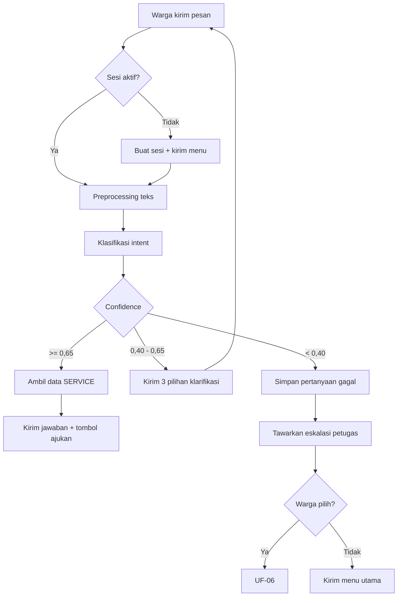

| Langkah | Sistem | Warga melihat |
|:--|:---|:---|
| 1 | Terima pesan, buat/lanjutkan sesi | — |
| 2 | Normalisasi + klasifikasi | "Sedang mengetik…" (maks 2 detik) |
| 3 | Ambil `SERVICE.persyaratan`, `alur`, `sla_hari`, `biaya` | — |
| 4 | Susun balasan dari data, bukan teks statis | Daftar persyaratan bernomor + tombol "Buatkan sekarang" |
| 5 | Simpan `chat_message` masuk dan keluar | — |

**Contoh pertukaran:**

```text
Warga : syarat bikin surat usaha apa aja?
Bot   : Untuk Surat Keterangan Usaha, Bapak/Ibu perlu menyiapkan:
        1. Fotokopi KTP
        2. Fotokopi KK
        3. Surat pengantar dari kepala dusun
        Estimasi selesai 1 hari kerja, tanpa biaya.
        Apakah ingin saya bantu buatkan sekarang?
        [Ya, buatkan]  [Lihat layanan lain]
```

**Jalur alternatif:**

| Kondisi | Perilaku |
|:---|:---|
| Pertanyaan di luar cakupan ("berapa harga cabai?") | Confidence rendah → eskalasi, bukan jawaban mengarang |
| Pertanyaan tentang layanan fase 2 ("surat keterangan kematian") | "Layanan tersebut belum tersedia melalui chatbot. Silakan hubungi petugas desa." |
| Warga mengirim pesan kosong atau stiker | "Maaf, saya belum bisa membaca pesan itu. Boleh diketik ulang?" |
| Warga mengirim 5 pesan dalam 10 detik | Rate limit → "Mohon tunggu sebentar, saya sedang memproses pesan sebelumnya." |

---

## UF-02 — Mengajukan Surat

**Aktor:** Warga
**Tujuan:** mendapatkan surat keterangan tanpa datang ke kantor desa.
**Prasyarat:** sesi aktif; pengajuan aktif < 3.

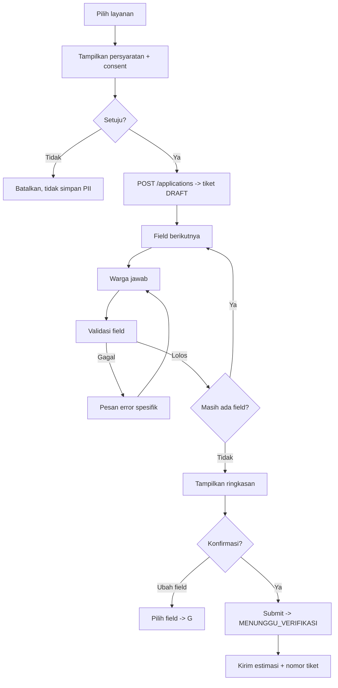

| Langkah | Sistem | Warga melihat |
|:--|:---|:---|
| 1 | Tampilkan persyaratan dan teks persetujuan | "Sebelum lanjut, kami perlu menyimpan data Bapak/Ibu untuk membuat surat. Setuju?" |
| 2 | Simpan consent (`consent_at`, `consent_version`) | — |
| 3 | Buat tiket `APP-{YYYY}-{seq}` status `DRAFT` | "Baik, pengajuan dimulai. Nomor pengajuan: APP-2026-000128" |
| 4 | Tanyakan field sesuai `urutan` | "Boleh kami tahu NIK Bapak/Ibu?" |
| 5 | Validasi tiap jawaban | Jika salah: "NIK harus 16 angka. Bapak/Ibu memasukkan 12 angka." |
| 6 | Tampilkan ringkasan | Daftar field dengan NIK ter-mask + tombol "Ubah" per baris |
| 7 | Submit → `MENUNGGU_VERIFIKASI` | "Pengajuan sudah kami terima. Petugas akan memeriksa dalam 1 hari kerja." |

**Aturan pengalaman:**

*   Sistem **hanya** menanyakan field yang belum terisi.
*   Warga dapat mengetik `ubah nik` kapan saja untuk mengoreksi.
*   Progres ditampilkan: "Langkah 3 dari 9".
*   Bila warga berhenti > 30 menit, progres tetap tersimpan; saat kembali, sistem menawarkan melanjutkan.
*   Tidak ada field yang ditanyakan dua kali.

**Jalur alternatif:**

| Kondisi | Perilaku |
|:---|:---|
| 3 pengajuan aktif | Tampilkan nomor tiket yang masih aktif + saran membatalkan atau menunggu |
| Warga membatalkan di tengah | Status `DIBATALKAN`; data tetap tersimpan untuk audit tetapi tidak diproses |
| Warga mengirim foto KTP | "Untuk tahap ini cukup diketik. Foto KTP dibawa saat pengambilan bila diminta petugas." (fase 2: unggah lampiran) |
| Data tidak konsisten (NIK ≠ tanggal lahir) | Operator akan memverifikasi; warga diberi tahu bahwa data akan diperiksa |

---

## UF-03 — Melacak Status Pengajuan

**Aktor:** Warga
**Tujuan:** mengetahui posisi pengajuannya tanpa menelepon kantor.

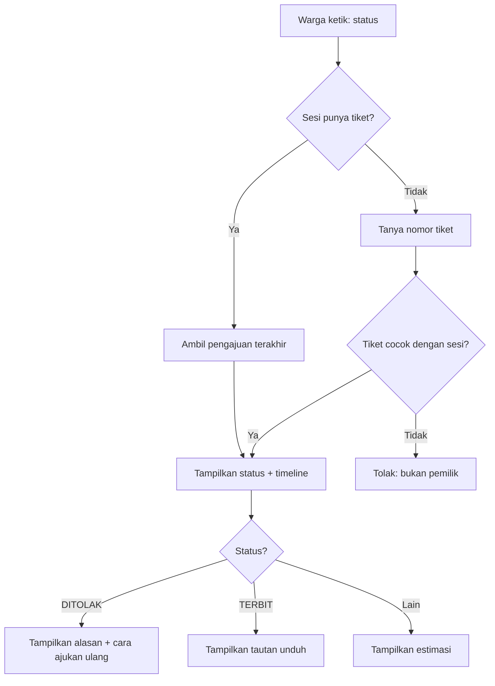

| Status | Pesan ke warga |
|:---|:---|
| `DRAFT` | "Pengajuan belum dikirim. Ingin lanjutkan sekarang?" |
| `MENUNGGU_VERIFIKASI` | "Sedang menunggu pemeriksaan petugas. Estimasi 1 hari kerja." |
| `DIPROSES` | "Sedang diproses dan ditandatangani Kepala Desa." |
| `TERBIT` | "Surat sudah terbit. Nomor: 128/DKP/XI/2026. [Unduh PDF]" |
| `DITOLAK` | "Pengajuan belum bisa diproses karena: <alasan>. Silakan ajukan ulang setelah dilengkapi." |
| `DIBATALKAN` | "Pengajuan ini sudah dibatalkan." |

**Keamanan:** warga hanya dapat melihat pengajuan yang dibuat dari sesi/kanal yang sama. Mencoba nomor tiket milik orang lain menghasilkan "Nomor pengajuan tidak ditemukan pada percakapan ini."

---

## UF-04 — Menerima & Memverifikasi Dokumen

**Aktor:** Warga
**Tujuan:** mendapatkan PDF sah dan memahami cara memverifikasinya.

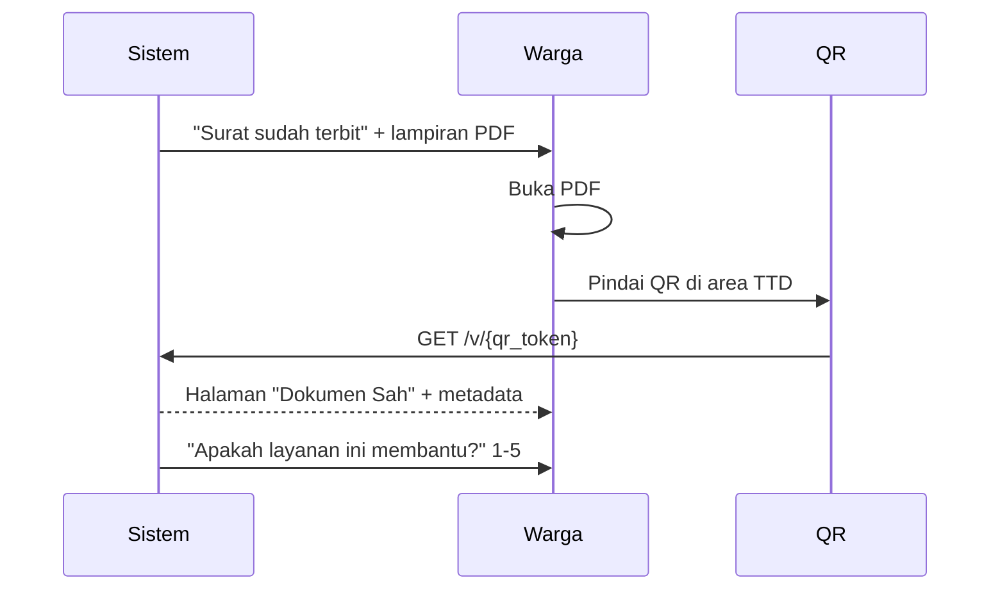

| Langkah | Detail |
|:--|:---|
| 1 | PDF dikirim ke kanal asal dalam ≤ 10 detik setelah persetujuan |
| 2 | Bila pengiriman gagal, dikirim tautan `/d/{token}` berlaku 7 hari |
| 3 | PDF memuat QR 2,5 × 2,5 cm di dekat tanda tangan |
| 4 | Warga memindai → halaman verifikasi menampilkan status `SAH` |
| 5 | Sistem meminta penilaian 1–5 (sekali per pengajuan) |

**Yang dilihat pada halaman verifikasi:**

```text
┌────────────────────────────────────────┐
│              ✓  DOKUMEN SAH            │
│                                        │
│  Surat Keterangan Tidak Mampu          │
│  Nomor: 128/DKP/XI/2026                │
│  Terbit: 3 November 2026               │
│                                        │
│  Nama  : Ahmad F***                    │
│  NIK   : ************0001              │
│  Dusun : Buntulu                       │
│  TTD   : Hj. Rosmiati, Kepala Desa     │
│                                        │
│  Sidik: 9f2c1e7b4a8d3f60…              │
│                                        │
│  [Laporkan kejanggalan]                │
└────────────────────────────────────────┘
```

---

## UF-05 — Membatalkan Pengajuan

**Aktor:** Warga
**Prasyarat:** status `DRAFT` atau `MENUNGGU_VERIFIKASI`.

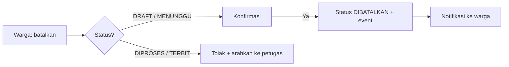

| Kondisi | Perilaku |
|:---|:---|
| `DRAFT` | Langsung dapat dibatalkan |
| `MENUNGGU_VERIFIKASI` | Dapat dibatalkan; operator melihat status berubah |
| `DIPROSES` | Tidak dapat dibatalkan sendiri; harus menghubungi petugas |
| `TERBIT` | Tidak dapat dibatalkan; bila bermasalah, dokumen dicabut oleh Kepala Desa |

---

## UF-06 — Meminta Bantuan Petugas

**Aktor:** Warga
**Pemicu:** warga mengetik "bicara dengan petugas", atau dua kali gagal dikenali, atau memilih tombol eskalasi.

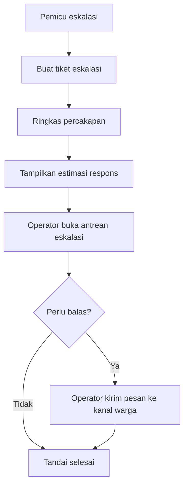

| Langkah | Detail |
|:--|:---|
| 1 | Tiket memuat 5 pesan terakhir sebagai konteks |
| 2 | Warga menerima: "Permintaan Bapak/Ibu sudah kami teruskan. Petugas akan membalas pada jam layanan (Senin–Jumat, 08.00–15.00 WITA)." |
| 3 | Di luar jam layanan, ditambahkan: "Pesan akan dibalas pada hari kerja berikutnya." |
| 4 | Operator membalas dari panel admin; pesan terkirim ke kanal asal warga |
| 5 | Tiket ditandai selesai setelah operator menutupnya |

---

## UF-07 — Memverifikasi Keaslian Dokumen

**Aktor:** Verifikator eksternal (bank, sekolah, dinas, perusahaan)
**Prasyarat:** memiliki dokumen cetak atau PDF.

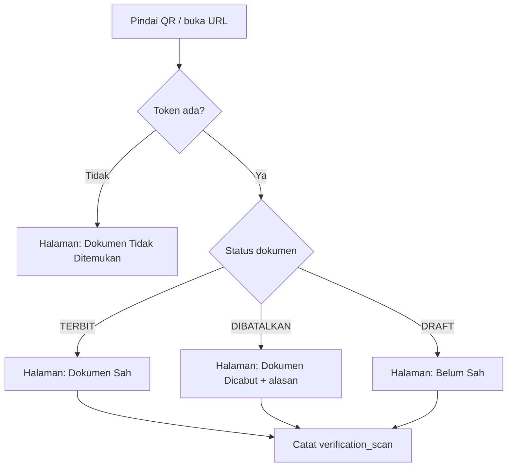

| Yang ditampilkan | Yang **tidak** ditampilkan |
|:---|:---|
| Status keabsahan | NIK lengkap |
| Jenis dan nomor surat | Alamat lengkap |
| Tanggal terbit | Berkas PDF |
| Nama ter-mask | Data keluarga |
| Nama dan jabatan penandatangan | Nomor HP warga |
| Hash SHA-256 | — |

**Untuk sistem instansi:** `GET /api/v1/verify/{qr_token}` mengembalikan JSON yang sama, dibatasi 60 permintaan/menit/IP.

**Jalur alternatif:**

| Kondisi | Perilaku |
|:---|:---|
| QR rusak/tidak terbaca | Halaman menyediakan form input nomor surat manual |
| Nomor surat ditemukan tetapi token berbeda | Tetap tampilkan status berdasarkan nomor; catat anomali |
| Dokumen palsu dengan QR mengarah ke domain lain | Halaman resmi mencantumkan domain yang benar agar dapat dibandingkan |
| Pemindaian berulang 20 kali dalam 1 menit | Rate limit + catat sebagai anomali |

---

## UF-08 — Meninjau & Mengoreksi Pengajuan

**Aktor:** Operator
**Prasyarat:** login dengan peran `operator`.

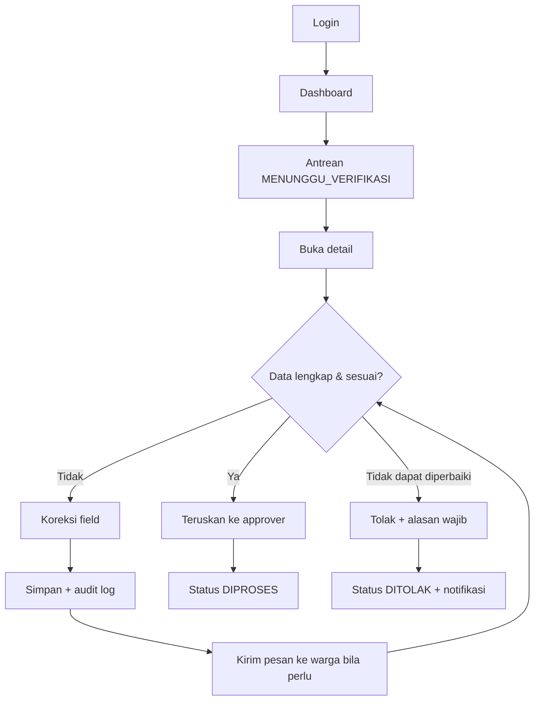

| Langkah | Detail |
|:--|:---|
| 1 | Daftar menampilkan lama menunggu (jam) agar prioritas jelas |
| 2 | Detail menampilkan data pemohon, form_data, lampiran, timeline |
| 3 | Koreksi mencatat nilai lama → nilai baru pada audit log |
| 4 | Bila berkas kurang, operator mengirim pesan langsung ke kanal warga |
| 5 | Penolakan memerlukan alasan ≥ 10 karakter yang diteruskan ke warga |
| 6 | Setelah diteruskan, status menjadi `DIPROSES` dan masuk antrean approver |

**Batas peran:** operator **tidak dapat** menerbitkan dokumen. Hanya `sekdes` dan `kepala_desa` yang dapat menyetujui.

---

## UF-09 — Menyetujui & Menerbitkan Dokumen

**Aktor:** Sekdes atau Kepala Desa

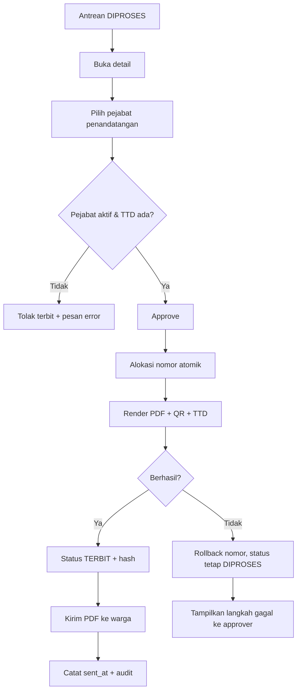

| Langkah | Detail |
|:--|:---|
| 1 | Approver melihat pratinjau PDF sebelum menyetujui |
| 2 | Pejabat dipilih otomatis berdasarkan jabatan dan tanggal, dapat diubah |
| 3 | Nomor dialokasikan dalam transaksi yang sama dengan pembuatan dokumen |
| 4 | QR dan TTD ditempel sebelum hash dihitung |
| 5 | PDF dikirim ke kanal warga; `sent_at` dicatat |
| 6 | Bila pengiriman gagal, tautan unduhan 7 hari dibuat |

**Jalur alternatif:**

| Kondisi | Perilaku |
|:---|:---|
| Tidak ada pejabat aktif | Tombol setujui nonaktif + "Tidak ada pejabat aktif untuk jabatan ini" |
| TTD pejabat tidak ada | Penerbitan ditolak; arahkan ke pengaturan pejabat |
| Placeholder template tidak cocok | Penerbitan gagal dengan pesan spesifik; nomor dikembalikan |
| Dua approver menekan setujui bersamaan | Satu berhasil, satu menerima `409 INVALID_TRANSITION` |

---

## UF-10 — Mengelola Template & Nomor Surat

**Aktor:** Sekdes

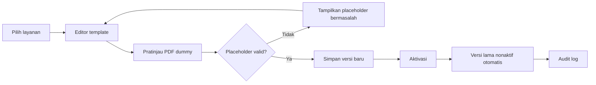

| Tugas | Langkah |
|:---|:---|
| Ubah redaksi surat | Edit template → pratinjau → simpan versi baru → aktivasi |
| Tambah layanan baru | Buat layanan → definisikan field → buat template → aktifkan |
| Perbaiki nomor surat | Lihat counter → override dengan alasan → verifikasi tidak duplikat |
| Reset counter tahun baru | Reset dengan konfirmasi ganda → counter mulai dari 0 |

**Aturan:** perubahan template tidak memengaruhi dokumen yang sudah terbit. Dokumen lama tetap merujuk versi yang dipakai saat diterbitkan.

---

## UF-11 — Melabeli Pertanyaan Gagal & Melatih Model

**Aktor:** Admin Teknis

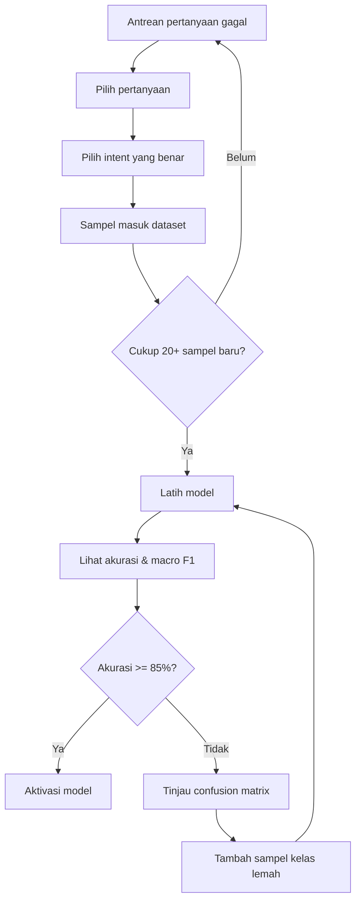

| Langkah | Detail |
|:--|:---|
| 1 | Antrean menampilkan teks, confidence, kanal, dan tanggal |
| 2 | Pelabelan satu klik per pertanyaan; dapat menandai "di luar cakupan" |
| 3 | Pelatihan memakai split 80/20 stratifikasi dengan seed tetap |
| 4 | Metrik ditampilkan per kelas beserta confusion matrix |
| 5 | Aktivasi ditolak bila akurasi < 85% tanpa catatan alasan |
| 6 | Rollback ke model sebelumnya tersedia dalam satu aksi |

**Ritme:** minimal sekali sebulan, atau segera setelah 50 pertanyaan gagal terkumpul.

---

## UF-12 — Mengaudit & Menyusun Laporan

**Aktor:** Sekdes

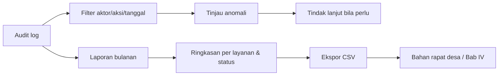

| Yang diperiksa | Frekuensi | Indikator anomali |
|:---|:---|:---|
| Penerbitan di luar jam kerja | Mingguan | Penerbitan pukul 02.00 |
| Penolakan dengan alasan seragam | Bulanan | Satu alasan dipakai > 10 kali |
| Override nomor surat | Setiap kejadian | Lebih dari 2 kali sebulan |
| Akses akun dari IP baru | Mingguan | Login dari luar Indonesia |
| Pemindaian QR berlebihan | Bulanan | Satu dokumen dipindai > 100 kali |

**Keluaran laporan bulanan:** jumlah pengajuan per layanan, per status, rata-rata waktu proses, tingkat penolakan beserta alasan terbanyak, skor kepuasan, dan akurasi model aktif.

---

## Matriks Transisi Status

| Dari | Aksi | Ke | Aktor yang berhak |
|:---|:---|:---|:---|
| — | Buat pengajuan | `DRAFT` | Warga |
| `DRAFT` | Submit | `MENUNGGU_VERIFIKASI` | Warga |
| `DRAFT` | Batalkan | `DIBATALKAN` | Warga |
| `MENUNGGU_VERIFIKASI` | Teruskan | `DIPROSES` | Operator |
| `MENUNGGU_VERIFIKASI` | Tolak | `DITOLAK` | Operator |
| `MENUNGGU_VERIFIKASI` | Batalkan | `DIBATALKAN` | Warga |
| `DIPROSES` | Setujui & terbitkan | `TERBIT` | Sekdes, Kepala Desa |
| `DIPROSES` | Tolak | `DITOLAK` | Operator, Sekdes |
| `DIPROSES` | Batalkan | `DIBATALKAN` | Sekdes |
| `TERBIT` | Cabut dokumen | `DIBATALKAN` (dokumen) | Kepala Desa |

Transisi di luar tabel ini ditolak dengan `409 INVALID_TRANSITION`.
