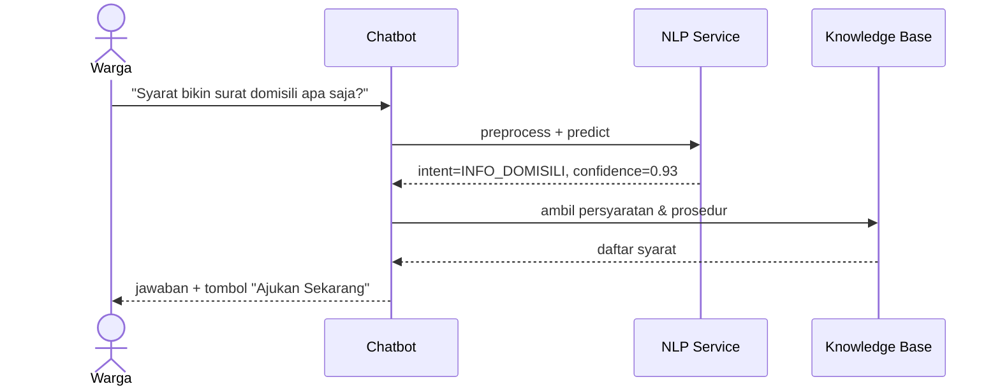
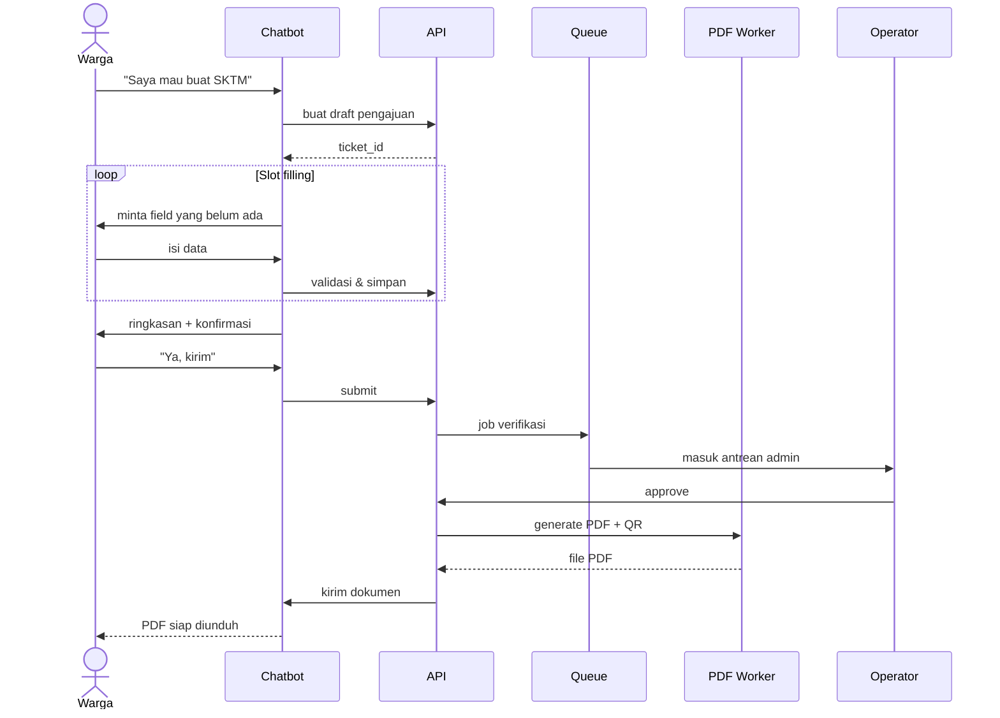
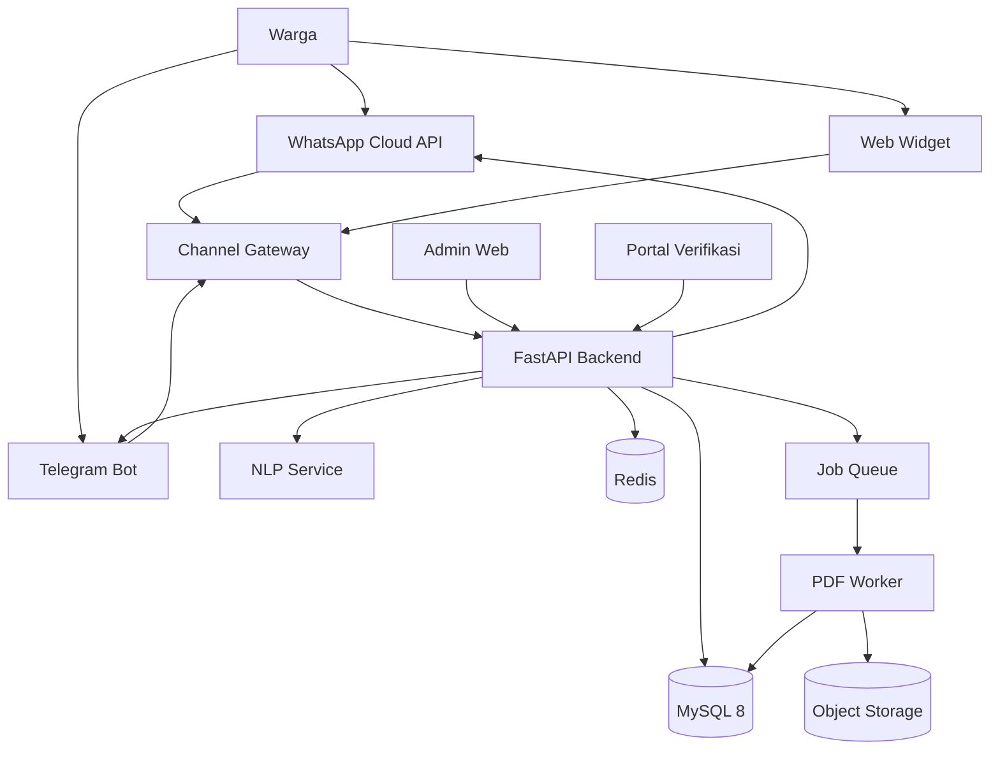
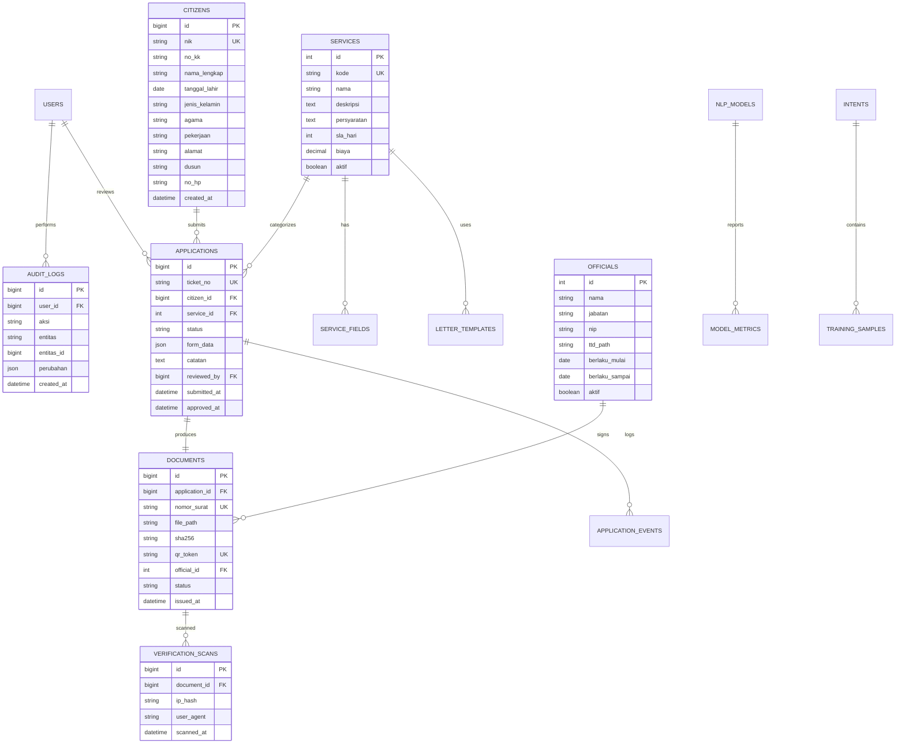

# PRD: SILADESA — Chatbot NLP & Otomasi Dokumen Administrasi Desa Kampala

| Atribut | Keterangan |
|:--|:--|
| **Nama produk (working title)** | SILADESA (Sistem Layanan Administrasi Desa) |
| **Jenis produk** | Aplikasi internal desa + kanal layanan masyarakat (chatbot & portal verifikasi) |
| **Pemilik produk** | Pemerintah Desa Kampala, Kecamatan Arungkeke, Kabupaten Jeneponto |
| **Penyusun** | Dzaljalali Wal Ikram HS (E1A122016), S1 Ilmu Informatika, Universitas Megarezky |
| **Versi dokumen** | 1.0 |
| **Tanggal** | 17 Oktober 2026 |
| **Status** | Draft untuk validasi dosen pembimbing & perangkat desa |
| **Sumber utama** | `Skripsi ikram-2_safe.docx` (Bab I–III) dan arsip `Format surat/` |
| **Target rilis MVP** | 8–12 minggu setelah kickoff (baseline Tabel 3.1: Mei–Juli) |

---

## 1. Ringkasan Eksekutif

SILADESA adalah sistem layanan administrasi Desa Kampala yang menggabungkan tiga hal:

1. **Chatbot berbasis Natural Language Processing (NLP)** yang memahami pertanyaan warga dalam bahasa Indonesia sehari-hari, termasuk variasi dialek dan singkatan lokal.
2. **Otomasi penerbitan dokumen** surat keterangan desa dalam format PDF, lengkap dengan nomor surat, kop surat, tanda tangan Kepala Desa, dan **QR Code verifikasi keabsahan**.
3. **Halaman admin web** untuk mengelola template surat, data layanan, nomor surat, persetujuan, basis pengetahuan, dan evaluasi model NLP.

Sistem dibangun **mandiri (self-hosted)**: model NLP dilatih sendiri dengan dataset lokal, dijalankan di server desa atau VPS, dan **tidak memanggil API LLM pihak ketiga** (ChatGPT, Claude, Gemini). Data warga tidak keluar dari lingkup desa.

Hasil yang diharapkan: layanan informasi 24 jam, waktu tunggu turun dari hitungan jam menjadi hitungan detik, beban pertanyaan berulang aparat desa berkurang, dan dokumen yang diterbitkan dapat diverifikasi keasliannya oleh pihak ketiga (bank, sekolah, dinas) hanya dengan memindai QR.

---

## 2. Latar Belakang & Problem Statement

### 2.1 Konteks

Desa Kampala memiliki kantor desa dengan jam layanan terbatas (08.00–16.00 WITA). Seluruh permintaan informasi dan surat keterangan saat ini dilayani secara tatap muka. Arsip `Format surat/` menunjukkan ada **17+ jenis surat** yang rutin diterbitkan, mulai dari Surat Keterangan Domisili, SKTM, Keterangan Usaha, Surat Pengantar, hingga Keterangan Kematian, Ahli Waris, dan Jual Beli Tanah.

### 2.2 Masalah utama

| Kode | Masalah | Dampak |
|:--|:--|:--|
| **P1** | Informasi persyaratan hanya tersedia saat jam kerja dan harus ditanyakan langsung | Warga datang berulang, pulang tanpa dokumen lengkap |
| **P2** | Pertanyaan yang sama dijawab berulang oleh aparat desa | Waktu aparat habis untuk pekerjaan repetitif |
| **P3** | Antrean fisik di kantor desa, terutama saat musim pengurusan berkas | Pelayanan lambat, kepuasan warga rendah |
| **P4** | Surat yang diterbitkan tidak punya mekanisme verifikasi cepat | Risiko pemalsuan, pihak ketiga harus konfirmasi manual ke kantor desa |
| **P5** | Belum ada kanal digital resmi milik desa | Warga bergantung pada informasi mulut ke mulut yang tidak konsisten |

### 2.3 Peluang

- 85%+ warga usia produktif memiliki smartphone dan WhatsApp (asumsi awal, perlu validasi survei).
- Model NLP ringan (TF-IDF + linear classifier) mampu mencapai akurasi tinggi untuk domain tertutup seperti 17 jenis layanan desa.
- QR code dan PDF generator sudah tersedia sebagai library open source sehingga biaya operasional mendekati nol.
- Regulasi desa mendukung digitalisasi layanan (UU No. 6 Tahun 2014, e-government, smart village).

---

## 3. Tujuan & Metrik Keberhasilan

### 3.1 Tujuan produk

| Kode | Tujuan | Indikator |
|:--|:--|:--|
| **G1** | Menyediakan informasi layanan administrasi 24 jam | Chatbot dapat menjawab pertanyaan persyaratan tanpa petugas |
| **G2** | Mengotomasi penerbitan draft surat keterangan | PDF terbit < 5 detik setelah data tervalidasi |
| **G3** | Menjamin keabsahan dokumen | Setiap dokumen punya QR yang mengarah ke halaman verifikasi |
| **G4** | Mengurangi beban aparat desa | Minimal 50% pertanyaan rutin ditangani chatbot |
| **G5** | Memberi dasar evaluasi ilmiah | Akurasi intent, confusion matrix, dan skor kepuasan terukur |

### 3.2 Metrik keberhasilan (selaras skripsi)

| Metrik | Baseline | Target MVP | Cara ukur |
|:--|:--|:--|:--|
| Akurasi pengenalan intent | Belum ada sistem | **≥ 85%** | Test set 20% + 100 test case manual |
| Macro F1-score | — | ≥ 0.80 | Classification report |
| Waktu respons chatbot (p95) | — | ≤ 2 detik | Log aplikasi |
| Waktu generate PDF (p95) | — | ≤ 5 detik | Log worker |
| Keberhasilan scan QR | — | ≥ 98% | Uji 5 kamera × 20 dokumen |
| Task completion rate pengajuan | — | ≥ 80% | Funnel analytics |
| Skor SUS | — | ≥ 70 (acceptable) | Kuesioner 10 item, n sesuai Slovin |
| Penurunan kunjungan informasi ke kantor | Data manual | ≥ 50% | Log kunjungan 1 bulan sebelum/sesudah |
| Insiden kebocoran data | — | 0 | Audit log & monitoring |

### 3.3 Non-goals (tidak dikerjakan di MVP)

- Bukan pengganti sistem kependudukan (SIAK) atau Dukcapil; tidak melakukan sinkronisasi NIK real-time.
- Tidak menerbitkan dokumen yang menurut regulasi wajib ditandatangani basah pejabat berwenang di luar desa (mis. sertifikat tanah BPN).
- Tidak menyediakan pembayaran online, pengaduan hukum, atau layanan di luar administrasi desa.
- Tidak menggunakan LLM generatif pihak ketiga.
- Tidak melakukan verifikasi biometrik atau e-KTP reader.

---

## 4. Pengguna & Peran

### 4.1 Persona

| Persona | Deskripsi | Kebutuhan utama | Kanal |
|:--|:--|:--|:--|
| **Warga pemohon** | Penduduk Desa Kampala, 17–65 tahun, familiar WhatsApp | Tahu syarat, ajukan surat, unduh PDF | WhatsApp / Telegram / web widget |
| **Warga verifikator** | Pihak ketiga (bank, sekolah, dinas) yang menerima surat | Cek keaslian dokumen dalam < 30 detik | Scan QR / portal publik |
| **Operator layanan** | Staf kantor desa yang memverifikasi berkas | Review pengajuan, koreksi data, terbitkan/tolak | Admin web |
| **Sekretaris Desa** | Penanggung jawab administrasi | Kelola template, nomor surat, laporan | Admin web |
| **Kepala Desa** | Pejabat penandatangan | Approve dokumen, kelola pejabat & TTD | Admin web |
| **Admin teknis** | Pengelola sistem/model | Kelola user, dataset, retrain, backup | Admin web |

### 4.2 Matriks hak akses (RBAC)

| Kapabilitas | Warga | Operator | Sekdes | Kepala Desa | Admin Teknis |
|:--|:--:|:--:|:--:|:--:|:--:|
| Chat & ajukan surat | ✅ | ✅ | ✅ | ✅ | ✅ |
| Lihat pengajuan sendiri | ✅ | ✅ | ✅ | ✅ | ✅ |
| Lihat semua pengajuan | ❌ | ✅ | ✅ | ✅ | ✅ |
| Verifikasi/koreksi data | ❌ | ✅ | ✅ | ✅ | ✅ |
| Approve & terbitkan dokumen | ❌ | ❌ | ✅ | ✅ | ❌ |
| Kelola template surat | ❌ | ❌ | ✅ | ✅ | ✅ |
| Kelola nomor surat | ❌ | ❌ | ✅ | ✅ | ✅ |
| Kelola pejabat & scan TTD | ❌ | ❌ | ❌ | ✅ | ✅ |
| Kelola basis pengetahuan | ❌ | ✅ | ✅ | ✅ | ✅ |
| Latih ulang model NLP | ❌ | ❌ | ❌ | ❌ | ✅ |
| Lihat audit log | ❌ | ❌ | ✅ | ✅ | ✅ |
| Kelola user & role | ❌ | ❌ | ❌ | ❌ | ✅ |

---

## 5. Scope

### 5.1 MVP (P0) — 8–12 minggu

1. Chatbot 3 kanal: **WhatsApp**, **Telegram**, dan **web widget**.
2. NLP pipeline: normalisasi teks, tokenisasi, stopword removal, stemming Bahasa Indonesia, TF-IDF, klasifikasi intent.
3. **4 jenis surat** sesuai Batasan Masalah: **Domisili, SKTM, Usaha, Pengantar**.
4. Slot filling multi-turn dengan validasi NIK, tanggal, dan field wajib.
5. Generate PDF A4 dengan kop surat, nomor otomatis, scan TTD Kepala Desa, dan QR verifikasi.
6. Portal verifikasi publik berbasis token QR.
7. Admin web: dashboard, pengajuan, template, nomor surat, pejabat, basis pengetahuan, dataset, evaluasi model, audit log.
8. Notifikasi status pengajuan ke warga.
9. Backup harian dan audit log.

### 5.2 Fase 2 (P1) — setelah MVP

- Tambah 13 jenis surat lain dari arsip `Format surat/` (lihat §8).
- Integrasi TTE BSrE bila tersedia.
- Mode intranet/offline penuh untuk kantor desa.
- Dasbor statistik layanan bulanan dan ekspor laporan.
- Kiosk mode di kantor desa.
- Kanal tambahan: Instagram DM / Facebook Messenger (opsional).

### 5.3 Out of scope

Lihat §3.3. Selain itu: aplikasi mobile native, integrasi pembayaran, dan integrasi langsung ke SIAK Dukcapil.

### 5.4 Asumsi & dependensi

| Kode | Asumsi/Dependensi | Dampak bila salah |
|:--|:--|:--|
| A1 | Nomor WhatsApp Business tersedia dan dapat diverifikasi Meta | Kanal utama tertunda; fallback ke Telegram + web |
| A2 | Server/VPS dengan 4 vCPU, 8 GB RAM, 100 GB SSD tersedia | Model IndoBERT tidak bisa dijalankan; pakai model linear |
| A3 | Data monografi desa (jumlah penduduk/KK) tersedia untuk Slovin | Sampel evaluasi tidak bisa dihitung |
| A4 | Kepala Desa menyetujui penggunaan scan TTD digital | Penerbitan otomatis tidak bisa; harus tanda tangan basah |
| A5 | Format nomor surat `{seq}/DKP/{bulan Romawi}/{tahun}` disetujui | Perlu konfigurasi ulang template nomor |
| A6 | Dataset minimal 600 ujaran berlabel dapat dikumpulkan | Akurasi 85% sulit dicapai |
| A7 | Kebijakan retensi data disepakati desa | Risiko kepatuhan UU PDP |

---

## 6. Functional Requirements

Prioritas: **P0** wajib MVP, **P1** fase 2, **P2** opsional.

### 6.1 Kanal & onboarding

| ID | Requirement | Prioritas | Acceptance Criteria |
|:--|:--|:--:|:--|
| **FR-01** | Sistem MUST menerima percakapan dari WhatsApp Cloud API, Telegram Bot API, dan web widget melalui satu lapisan adapter | P0 | Pesan dari 3 kanal masuk ke pipeline yang sama; balasan kembali ke kanal asal |
| **FR-02** | Sistem MUST mengidentifikasi pengguna berdasarkan nomor WhatsApp/Telegram ID atau sesi web | P0 | Sesi tersimpan 30 menit; percakapan dapat dilanjutkan |
| **FR-03** | Sistem MUST menampilkan menu layanan utama saat percakapan pertama | P0 | Menu berisi 4 layanan MVP + "Tanya hal lain" + "Bicara dengan petugas" |
| **FR-04** | Sistem MUST meminta persetujuan pemrosesan data pribadi sebelum pengajuan surat | P0 | Consent tersimpan dengan timestamp & versi kebijakan |
| **FR-05** | Sistem SHOULD mendeteksi pesan di luar jam layanan dan tetap merespons | P0 | Respons otomatis 24/7; eskalasi ke petugas dijawab pada jam kerja |
| **FR-06** | Sistem MUST menyediakan fallback ke petugas manusia bila intent tidak dikenali 2 kali berturut-turut | P0 | Tiket eskalasi dibuat; warga diberi estimasi respons |

### 6.2 NLP & percakapan

| ID | Requirement | Prioritas | Acceptance Criteria |
|:--|:--|:--:|:--|
| **FR-10** | Sistem MUST melakukan preprocessing: case folding, normalisasi singkatan/dialek, tokenisasi, stopword removal, stemming | P0 | Teks "syarat bikin SKTM ka?" → token bermakna `syarat`, `sktm` |
| **FR-11** | Sistem MUST mengklasifikasikan intent ke salah satu label layanan/FAQ/fallback | P0 | Output: `intent`, `confidence`, `top_3` |
| **FR-12** | Sistem MUST memakai ambang keyakinan yang dapat dikonfigurasi (default 0.65) | P0 | Di bawah ambang → klarifikasi, bukan jawaban asal |
| **FR-13** | Sistem MUST menangani percakapan multi-turn untuk mengisi slot data pemohon | P0 | Sistem menanyakan field yang belum terisi satu per satu |
| **FR-14** | Sistem MUST memvalidasi NIK (16 digit, struktur wilayah), tanggal, dan enum (agama, status, pekerjaan) | P0 | NIK salah → pesan koreksi spesifik, bukan error umum |
| **FR-15** | Sistem MUST menyimpan konteks sesi (intent aktif, slot terisi, riwayat) | P0 | Data sesi kedaluwarsa otomatis setelah 30 menit |
| **FR-16** | Sistem SHOULD mengenali pertanyaan berlapis, mis. "syarat domisili dan berapa lama prosesnya?" | P1 | Minimal intent utama dijawab; pertanyaan kedua dijawab dari FAQ |
| **FR-17** | Sistem MUST mencatat pertanyaan yang gagal dikenali ke antrean *unanswered questions* | P0 | Admin dapat melihat dan melabelinya untuk retrain |
| **FR-18** | Sistem MUST mendukung koreksi pengguna, mis. "bukan itu, maksud saya surat usaha" | P0 | Intent diperbarui tanpa memulai sesi dari awal |
| **FR-19** | Sistem SHOULD mendeteksi bahasa campuran Indonesia–Makassar dan singkatan umum | P1 | Daftar normalisasi mencakup minimal 50 istilah lokal |

### 6.3 Katalog layanan & basis pengetahuan

| ID | Requirement | Prioritas | Acceptance Criteria |
|:--|:--|:--:|:--|
| **FR-20** | Sistem MUST menyimpan katalog layanan: nama, kode, deskripsi, persyaratan, alur, estimasi waktu, biaya, jam layanan | P0 | Admin dapat CRUD tanpa mengubah kode |
| **FR-21** | Sistem MUST menyajikan persyaratan dan prosedur per layanan dari basis data, bukan hardcode | P0 | Perubahan di admin langsung tercermin di chatbot |
| **FR-22** | Sistem MUST menyediakan FAQ umum: jam layanan, lokasi, syarat KTP/KK, biaya, lama proses | P0 | Minimal 20 FAQ terisi saat go-live |
| **FR-23** | Sistem MUST menampilkan daftar dusun dan alamat kantor desa | P1 | Data dusun: Buntulu, Kalukuang, Monroloe, Pinyangkabung, Sepeka (dapat ditambah) |
| **FR-24** | Sistem SHOULD menyediakan pencarian layanan berbasis kata kunci bila intent ambigu | P1 | Menampilkan maksimal 5 kandidat layanan |

### 6.4 Pengajuan & validasi data

| ID | Requirement | Prioritas | Acceptance Criteria |
|:--|:--|:--:|:--|
| **FR-30** | Sistem MUST membuat tiket pengajuan dengan status: `DRAFT`, `MENUNGGU_VERIFIKASI`, `DIPROSES`, `TERBIT`, `DITOLAK`, `DIBATALKAN` | P0 | Setiap transisi status tercatat di audit log |
| **FR-31** | Sistem MUST menampilkan ringkasan data sebelum submit | P0 | Warga dapat mengubah field sebelum konfirmasi |
| **FR-32** | Sistem MUST mencegah pengajuan ganda: maksimal 3 pengajuan aktif per NIK per 24 jam | P0 | Pengajuan ke-4 ditolak dengan pesan jelas |
| **FR-33** | Sistem MUST menyimpan snapshot data pemohon pada saat pengajuan | P0 | Perubahan data master tidak mengubah dokumen lama |
| **FR-34** | Sistem MUST mengirim notifikasi saat status berubah | P0 | Pesan berisi nomor pengajuan, status, dan alasan bila ditolak |
| **FR-35** | Sistem SHOULD mendukung unggah berkas pendukung (KTP/KK/foto) maksimal 5 MB per file | P1 | Format JPG/PNG/PDF; file dipindai antivirus |
| **FR-36** | Sistem MUST menyediakan pembatalan pengajuan oleh warga sebelum status `DIPROSES` | P0 | Status berubah ke `DIBATALKAN`; nomor surat tidak terpakai |
| **FR-37** | Sistem MUST menolak pengajuan yang NIK-nya tidak sesuai pola wilayah Jeneponto (73.04) tanpa verifikasi manual | P1 | Pesan: "NIK bukan wilayah Kabupaten Jeneponto, silakan hubungi kantor desa" |

### 6.5 Penerbitan dokumen PDF & QR

| ID | Requirement | Prioritas | Acceptance Criteria |
|:--|:--|:--:|:--|
| **FR-40** | Sistem MUST menghasilkan PDF A4 dari template dengan kop surat, judul, nomor, isi, dan blok tanda tangan | P0 | Layout sesuai contoh `Format surat/`; margin 2,5–3 cm |
| **FR-41** | Sistem MUST mengalokasikan nomor surat secara atomik dan unik | P0 | Tidak ada duplikat pada 100 permintaan paralel |
| **FR-42** | Format nomor MUST mengikuti pola `{seq:3d}/DKP/{bulan_romawi}/{tahun}` dan dapat dikonfigurasi | P0 | Contoh: `325/DKP/VI/2026` |
| **FR-43** | Sistem MUST menempelkan scan TTD Kepala Desa dan QR code pada area tanda tangan | P0 | Posisi tidak menutupi teks; QR minimal 2,5 × 2,5 cm |
| **FR-44** | Sistem MUST menyisipkan QR yang mengarah ke URL verifikasi bertoken | P0 | Token tidak dapat ditebak; berlaku selama dokumen aktif |
| **FR-45** | Sistem MUST menyimpan hash SHA-256 dokumen dan menampilkannya di halaman verifikasi | P0 | Hash berubah bila PDF dimodifikasi |
| **FR-46** | Sistem MUST menandai dokumen sebagai `DRAFT` dengan watermark bila belum disetujui pejabat | P0 | Watermark "DRAFT — BELUM SAH" diagonal, abu-abu |
| **FR-47** | Sistem MUST mengirim PDF ke chat pemohon setelah status `TERBIT` | P0 | File terkirim ≤ 10 detik setelah approve |
| **FR-48** | Sistem SHOULD mendukung TTE BSrE bila kredensial tersedia | P1 | Tanda tangan tersemat dan tervalidasi |
| **FR-49** | Sistem MUST menyimpan arsip PDF dan metadata minimal 5 tahun | P0 | Backup harian; restore diuji |

### 6.6 Verifikasi publik

| ID | Requirement | Prioritas | Acceptance Criteria |
|:--|:--|:--:|:--|
| **FR-50** | Sistem MUST menyediakan halaman publik `/v/{token}` tanpa login | P0 | Menampilkan status, jenis, nomor, tanggal, nama ter-mask, dan hash |
| **FR-51** | Halaman verifikasi MUST menampilkan badge jelas: SAH / DIBATALKAN / TIDAK DITEMUKAN | P0 | Warna dan teks kontras (WCAG AA) |
| **FR-52** | Halaman verifikasi MUST tidak menampilkan NIK penuh atau alamat lengkap | P0 | Hanya 4 digit terakhir NIK |
| **FR-53** | Sistem SHOULD menyediakan endpoint API verifikasi untuk instansi | P1 | `GET /api/v1/verify/{token}` dengan rate limit |
| **FR-54** | Sistem MUST mencatat setiap pemindaian QR (waktu, IP ter-hash, user agent) | P0 | Log tersedia di admin |

### 6.7 Admin web

| ID | Requirement | Prioritas | Acceptance Criteria |
|:--|:--|:--:|:--|
| **FR-60** | Admin MUST memiliki login email + password (Argon2id) dan sesi aman | P0 | Lockout setelah 5 percobaan gagal |
| **FR-61** | Admin MUST menampilkan dashboard: pengajuan hari ini, menunggu verifikasi, terbit, ditolak, akurasi model | P0 | Data real-time ≤ 5 detik |
| **FR-62** | Admin MUST menyediakan daftar & detail pengajuan dengan filter status, layanan, tanggal, dusun | P0 | Pencarian NIK/nomor pengajuan |
| **FR-63** | Admin MUST memungkinkan koreksi data pemohon sebelum terbit | P0 | Perubahan tercatat: siapa, kapan, field apa |
| **FR-64** | Admin MUST menyediakan editor template surat berbasis placeholder | P0 | Placeholder `{{nama}}`, `{{nik}}`, `{{nomor}}` tervalidasi |
| **FR-65** | Admin MUST menyediakan pratinjau PDF sebelum approve | P0 | Preview identik dengan hasil final |
| **FR-66** | Admin MUST menyediakan manajemen pejabat: nama, jabatan, NIP, scan TTD, masa berlaku | P0 | Hanya satu pejabat aktif per jenis jabatan |
| **FR-67** | Admin MUST menyediakan manajemen nomor surat: counter per jenis/tahun, reset, override manual | P0 | Override wajib alasan + audit |
| **FR-68** | Admin MUST menyediakan CRUD basis pengetahuan & FAQ | P0 | Perubahan langsung aktif |
| **FR-69** | Admin MUST menyediakan antrean *unanswered questions* dan pelabelan intent | P0 | Label tersimpan ke dataset training |
| **FR-70** | Admin MUST menyediakan halaman evaluasi model: akurasi, F1, confusion matrix, versi model | P0 | Metrik dihitung dari test set tersimpan |
| **FR-71** | Admin MUST menyediakan audit log immutable | P0 | Filter user, aksi, entitas, tanggal; tidak dapat dihapus |
| **FR-72** | Admin SHOULD menyediakan ekspor laporan bulanan (CSV/PDF) | P1 | Rekap per layanan & status |
| **FR-73** | Admin SHOULD mendukung role-based menu visibility | P1 | Operator tidak melihat menu pejabat |
| **FR-74** | Admin MUST menyediakan pengaturan jam layanan, kontak, dan teks eskalasi | P0 | Tersimpan sebagai konfigurasi sistem |

### 6.8 Notifikasi & tindak lanjut

| ID | Requirement | Prioritas | Acceptance Criteria |
|:--|:--|:--:|:--|
| **FR-80** | Sistem MUST mengirim notifikasi pengajuan diterima, sedang diverifikasi, terbit, atau ditolak | P0 | Maksimal 1 notifikasi per transisi status |
| **FR-81** | Sistem MUST mengirim pengingat bila pengajuan menggantung > 2 hari kerja | P1 | Dikirim ke operator, bukan warga |
| **FR-82** | Sistem MUST menyediakan perintah "status" untuk cek pengajuan terakhir | P0 | Balasan berisi nomor & status |
| **FR-83** | Sistem SHOULD menyediakan survei kepuasan 1–5 setelah dokumen terbit | P1 | Skor tersimpan dan masuk laporan |

### 6.9 Evaluasi & pelatihan model

| ID | Requirement | Prioritas | Acceptance Criteria |
|:--|:--|:--:|:--|
| **FR-90** | Sistem MUST menyimpan dataset berlabel dengan versi | P0 | Setiap versi punya hash & tanggal |
| **FR-91** | Sistem MUST melakukan split train/test 80/20 secara stratifikasi | P0 | Distribusi kelas seimbang |
| **FR-92** | Sistem MUST menghitung accuracy, precision, recall, F1 per kelas | P0 | Laporan dapat diunduh |
| **FR-93** | Sistem MUST menyimpan model beserta metrik dan tanggal latih | P0 | Rollback ke versi sebelumnya |
| **FR-94** | Sistem SHOULD mendukung retrain terjadwal atau manual dari admin | P1 | Retrain tidak mengganggu layanan (blue-green) |
| **FR-95** | Sistem MUST menolak aktivasi model dengan akurasi < 85% tanpa persetujuan admin | P0 | Peringatan eksplisit + alasan |

---

## 7. Alur Pengguna Utama

### 7.1 Alur tanya informasi



**Pre-condition:** warga memulai percakapan.
**Post-condition:** warga mendapat informasi; sesi menyimpan intent terakhir.

### 7.2 Alur pengajuan surat



**Pre-condition:** data wajib lengkap dan consent diberikan.
**Post-condition:** dokumen terbit, nomor surat terpakai, audit log tercatat.

### 7.3 Alur verifikasi QR

1. Verifikator memindai QR pada surat.
2. Browser membuka `https://<domain>/v/{token}`.
3. Sistem memvalidasi token, menampilkan status, nomor, jenis, tanggal, nama ter-mask, dan hash.
4. Bila dokumen dibatalkan, halaman menampilkan peringatan merah.

### 7.4 Alur admin review

1. Operator membuka antrean `MENUNGGU_VERIFIKASI`.
2. Operator mencocokkan data dengan KTP/KK (bila diunggah).
3. Operator mengoreksi field bila perlu, lalu **Setujui** atau **Tolak** dengan alasan.
4. Sekdes/Kepala Desa menyetujui penerbitan (bila mode review aktif).
5. Sistem mengalokasikan nomor, membuat PDF, menempel TTD + QR, mengirim ke warga.

### 7.5 Alur retrain model

1. Admin membuka antrean *unanswered questions*.
2. Admin melabeli intent dan menambahkan parafrase.
3. Admin menjalankan retrain.
4. Sistem melatih model, menghitung metrik, menampilkan perbandingan.
5. Admin mengaktifkan model baru bila akurasi ≥ 85%.

---

## 8. Katalog Dokumen

### 8.1 Field umum (semua surat)

| Field | Tipe | Validasi | Wajib |
|:--|:--|:--|:--:|
| `nama_lengkap` | string | 3–100 karakter | ✅ |
| `nik` | string | tepat 16 digit, prefix `7304` | ✅ |
| `no_kk` | string | 16 digit | ⬜ |
| `tempat_lahir` | string | 3–50 karakter | ✅ |
| `tanggal_lahir` | date | format ISO, tidak di masa depan | ✅ |
| `jenis_kelamin` | enum | Laki-Laki / Perempuan | ✅ |
| `agama` | enum | Islam, Kristen, Katolik, Hindu, Buddha, Konghucu | ✅ |
| `status_perkawinan` | enum | Belum Kawin, Kawin, Cerai Hidup, Cerai Mati | ✅ |
| `pekerjaan` | string | 3–50 karakter | ✅ |
| `alamat` | string | dusun + RT/RW | ✅ |
| `dusun` | enum | Buntulu, Kalukuang, Monroloe, Pinyangkabung, Sepeka | ✅ |
| `no_hp` | string | 10–15 digit | ✅ |
| `keperluan` | string | 5–200 karakter | ✅ |

### 8.2 Surat MVP

| Kode | Surat | Field tambahan | Penandatangan | Mode default |
|:--|:--|:--|:--|:--|
| **DOM** | Surat Keterangan Domisili | `lama_tinggal`, `alamat_domisili` | Sekdes `a/n` Kepala Desa; saksi Kapolsek | Auto + review |
| **SKTM** | Surat Keterangan Tidak Mampu | `penghasilan_bulanan`, `jumlah_tanggungan`, `alasan` | Sekdes `a/n` Kepala Desa; saksi Kapolsek | Review |
| **USH** | Surat Keterangan Usaha | `nama_usaha`, `jenis_usaha`, `alamat_usaha`, `luas_lahan`, `modal`, `sejak_tahun`, `npwp`, `no_telp` | Sekdes `a/n` Kepala Desa | Review |
| **PGG** | Surat Pengantar | `jenis_pengantar` (SKCK/BBM/KTP-KK/Pindah/BPJS), `tujuan_instansi` | Kepala Desa / Sekdes | Auto + review |

### 8.3 Surat Fase 2 (dari arsip `Format surat/`)

| Kode | Surat | Field kunci | Sumber contoh |
|:--|:--|:--|:--|
| **KEM** | Keterangan Kematian | tanggal/jam/tempat/sebab meninggal, pemakaman, nomor KK | `Ket Kematian/Kematian - baru - Copy.docx` |
| **LAH** | Keterangan Lahir | data ibu, anak ke-, tanggal lahir | `Ket Kelahiran/Keterangan Lahir.docx` |
| **BLM** | Belum Menikah | pernyataan, status | `Ket Belum Menikah/Ket Belum Menikah.docx` |
| **SDM** | Sudah Menikah | data pasangan, tanggal akad, wali, mahar | `Ket Sudah Menikah/ket sudah menikah.docx` |
| **POT** | Penghasilan Orang Tua | universitas, data orang tua, penghasilan | `Ket Penghasilan orang tua/...docx` |
| **AWH** | Ahli Waris / Kuasa Ahli Waris | data pewaris, hubungan, daftar ahli waris, objek tanah + batas | `Ket Ahli Waris/Keterangan Ahli Waris.docx` |
| **JBT** | Jual Beli Tanah | pihak I/II, NOP, luas, harga, batas, saksi | `Jual Beli Tanah/...2026.docx` |
| **IZN** | Izin Pesta / Keramaian | jenis acara, hari/tanggal, tempat | `Izin Pesta/Izin Pesta.docx` |
| **SKCK** | Pengantar SKCK | keperluan, catatan kepolisian | `Peng SKCK/Peng SKCK.docx` |
| **BDT** | Keterangan BDT | daftar anggota keluarga, verifikasi kadus | `Ket BDT/ket BDT.docx` |
| **APT** | Kepemilikan Alat Pertanian | jenis alat, merk, jumlah, BBM | `Ket Kepemilikan/Ket Kepemilikan.docx` |
| **KUA** | Surat Kuasa | penerima kuasa, keperluan, rekening | `Ket Kuasa.docx` |
| **WLS** | Wali Siswa | data siswa, asal sekolah | `Keterangan Wali Siswa.docx` |
| **PNL** | Keterangan Penelitian | institusi, judul, periode | `Keterangan Penelitian.docx` |
| **PND** | Pindah Domisili | alamat asal/tujuan, jenis kepindahan | `PENGANTAR/Pengantar Pindah.docx` |
| **UND** | Undangan | agenda, waktu, tempat, tembusan | `Undangan/undangan.docx` |
| **PGN** | Surat Panggilan | perihal, waktu, tempat | `Surat Panggilan.docx` |

### 8.4 Aturan nomor, tanggal, dan penandatangan

- **Nomor:** `{seq:3d}/DKP/{bulan_romawi}/{tahun}`, counter terpisah per jenis surat dan tahun.
- **Bulan Romawi:** I–XII.
- **Override:** hanya Sekdes/Kepala Desa/Admin, wajib alasan, tercatat di audit log.
- **Tanggal surat:** tanggal persetujuan (bukan tanggal pengajuan).
- **Penandatangan:** diambil dari tabel `officials`, bukan hardcode. Bila pejabat berhalangan, gunakan `a/n` sesuai kebijakan desa.
- **Saksi:** Kapolsek Arungkeke untuk surat tertentu (Domisili, SKTM, SKCK, BDT) sesuai contoh arsip.
- **Bahasa:** baku, mengikuti template arsip; placeholder diisi otomatis dan dapat dikoreksi operator.

---

## 9. Arsitektur & Tech Stack

### 9.1 Gambaran sistem



### 9.2 Komponen

| Komponen | Tanggung jawab |
|:--|:--|
| **Channel Gateway** | Normalisasi pesan dari WhatsApp/Telegram/web, verifikasi signature, rate limit |
| **Conversation Orchestrator** | State machine sesi, slot filling, eskalasi |
| **NLP Service** | Preprocessing, vectorizer, classifier, confidence, top-3 intent |
| **Document Service** | Template rendering, numbering, PDF generation, QR, hash |
| **Verification Service** | Token, halaman publik, API verifikasi |
| **Admin Web** | CRUD layanan/template/pejabat, review, laporan, audit |
| **Worker** | Generate PDF, kirim pesan, retrain, backup |
| **Storage** | PDF arsip, scan TTD, lampiran, dataset, model artifact |

### 9.3 Stack

| Lapisan | Teknologi | Alasan |
|:--|:--|:--|
| Backend | Python 3.11 + FastAPI | Cepat, ekosistem NLP matang, async |
| NLP baseline | scikit-learn: TF-IDF + LinearSVC / Logistic Regression | Ringan, akurasi tinggi untuk domain tertutup, bisa jalan di VPS kecil |
| NLP lanjutan (opsional) | IndoBERT fine-tune (PyTorch/HuggingFace) | Bila data cukup dan server memadai |
| Preprocessing | Sastrawi (stemmer Indonesia), regex, kamus normalisasi lokal | Sesuai tahapan di skripsi |
| Database | MySQL 8 (produksi), SQLite (development) | Sesuai instrumen skripsi |
| Cache/Queue | Redis + Celery | Sesi, rate limit, job async |
| Admin web | Jinja2 + HTMX + Tailwind CSS (server-rendered) | Sesuai skripsi (HTML/CSS/JS), ringan, tanpa build tool berat |
| PDF | ReportLab | Kontrol layout presisi, font Times New Roman |
| QR | `qrcode` + Pillow | Ringan, sesuai skripsi |
| TTE (opsional) | BSrE | Hanya bila kredensial tersedia |
| Chat | WhatsApp Cloud API, Telegram Bot API, web widget | Kanal sesuai skripsi |
| Storage | Lokal + MinIO (S3-compatible) | Fleksibel untuk VPS maupun server desa |
| Deployment | Docker Compose + Nginx + Certbot | Reproducible, mudah dirawat |
| Monitoring | Uptime Kuma + log JSON + Sentry (opsional) | Deteksi gangguan cepat |
| Backup | `mysqldump` + rsync harian | RPO 24 jam |

### 9.4 Pipeline NLP

1. **Normalisasi:** lowercase, hapus karakter non-alfanumerik, perbaiki typo umum, ekspansi singkatan (`sktm`, `domisili`, `kk`, `ktp`).
2. **Tokenisasi:** pisahkan kata dan tanda baca.
3. **Stopword removal:** daftar stopword Indonesia + kata sapaan lokal.
4. **Stemming:** Sastrawi.
5. **Representasi:** TF-IDF (word + char n-gram) untuk baseline; embedding IndoBERT untuk fase lanjutan.
6. **Klasifikasi:** LinearSVC dengan `probability=True`, atau Logistic Regression untuk kalibrasi confidence.
7. **Ambang:** confidence ≥ 0.65 → jawab; 0.40–0.65 → klarifikasi; < 0.40 → fallback.
8. **Evaluasi:** accuracy, macro F1, per-class recall, confusion matrix.

### 9.5 Deployment

- **Produksi:** VPS 4 vCPU / 8 GB RAM / 100 GB SSD, Ubuntu 22.04, Docker Compose.
- **Alternatif offline:** mini PC di kantor desa, mode intranet, sinkronisasi terjadwal bila online.
- **Domain:** `layanan.desakampala.id` (contoh), SSL Let's Encrypt.
- **Jam operasional sistem:** 24/7; maintenance window 02.00–03.00 WITA.

---

## 10. Data Model

### 10.1 ERD



### 10.2 Entitas inti

| Tabel | Fungsi | Catatan |
|:--|:--|:--|
| `citizens` | Data pemohon | NIK unik; data sensitif dienkripsi at-rest |
| `services` | Katalog layanan | 4 MVP, 17 fase 2 |
| `service_fields` | Skema field per layanan | Tipe, wajib, urutan, validasi |
| `letter_templates` | Template surat | Versi, aktif, placeholder |
| `applications` | Tiket pengajuan | Menyimpan snapshot `form_data` |
| `application_events` | Riwayat status | Immutable |
| `documents` | Arsip PDF | Nomor, hash, token QR |
| `officials` | Pejabat & TTD | Masa berlaku |
| `verification_scans` | Log scan QR | Untuk audit |
| `users` | Akun admin | Role, password hash |
| `audit_logs` | Jejak semua aksi | Tidak dapat dihapus |
| `intents` | Label intent | Kode, deskripsi, aktif |
| `training_samples` | Dataset berlabel | Teks, intent, split |
| `nlp_models` | Versi model | Path, metrik, status |
| `settings` | Konfigurasi | Jam layanan, kontak, ambang |

### 10.3 Aturan integritas

- NIK unik di `citizens`; satu warga boleh punya banyak pengajuan.
- `documents.nomor_surat` unik per tahun.
- `documents.qr_token` unik dan tidak dapat ditebak (ULID + HMAC).
- `applications.status` hanya boleh bertransisi sesuai state machine.
- Penghapusan data menggunakan soft delete + retensi.
- Semua timestamp dalam UTC, ditampilkan dalam WITA.

---

## 11. API Contract

Base URL: `/api/v1`. Autentikasi admin: session cookie + CSRF. Autentikasi kanal: signature provider.

| Method | Path | Fungsi | Auth |
|:--|:--|:--|:--|
| POST | `/chat/message` | Kirim pesan ke chatbot | Channel signature |
| GET | `/services` | Daftar layanan aktif | Publik |
| GET | `/services/{kode}` | Detail layanan & persyaratan | Publik |
| POST | `/applications` | Buat draft pengajuan | Warga (sesi) |
| PATCH | `/applications/{id}` | Update slot/data | Warga (pemilik) |
| POST | `/applications/{id}/submit` | Submit pengajuan | Warga (pemilik) |
| POST | `/applications/{id}/cancel` | Batalkan pengajuan | Warga (pemilik) |
| GET | `/applications/{id}` | Detail & status | Warga/Admin |
| POST | `/applications/{id}/approve` | Setujui & terbitkan | Sekdes/Kades |
| POST | `/applications/{id}/reject` | Tolak dengan alasan | Operator+ |
| GET | `/documents/{id}/pdf` | Unduh PDF | Warga/Admin |
| GET | `/verify/{token}` | Halaman verifikasi | Publik |
| GET | `/verify/{token}/json` | Verifikasi via API | Publik (rate limit) |
| POST | `/admin/login` | Login admin | — |
| GET | `/admin/applications` | List pengajuan | Admin |
| CRUD | `/admin/services` | Kelola layanan | Sekdes+ |
| CRUD | `/admin/templates` | Kelola template | Sekdes+ |
| CRUD | `/admin/officials` | Kelola pejabat | Kades/Admin |
| POST | `/admin/models/train` | Retrain model | Admin teknis |
| GET | `/admin/models/{id}/metrics` | Metrik model | Admin |
| GET | `/admin/audit-logs` | Audit log | Sekdes+ |

### 11.1 Contoh: kirim pesan

**Request**

```json
{
  "channel": "whatsapp",
  "user_id": "62812xxxxxxx",
  "message": "syarat bikin surat domisili apa?",
  "message_id": "wamid.HBgM..."
}
```

**Response**

```json
{
  "reply": "Syarat Surat Keterangan Domisili:\n1. Fotokopi KTP\n2. Fotokopi KK\n3. Surat pengantar RT/RW\n\nKetik *AJUKAN* untuk mulai membuat surat.",
  "intent": "INFO_DOMISILI",
  "confidence": 0.93,
  "session_id": "ses_01J...",
  "quick_replies": ["AJUKAN", "Bicara dengan petugas"]
}
```

### 11.2 Contoh: verifikasi dokumen

**Response 200**

```json
{
  "valid": true,
  "status": "TERBIT",
  "jenis": "Surat Keterangan Domisili",
  "nomor": "325/DKP/VI/2026",
  "tanggal_terbit": "2026-06-23",
  "nama": "R**** A*****",
  "nik_masked": "************0001",
  "sha256": "9f2c...e41a",
  "diterbitkan_oleh": "Pemerintah Desa Kampala"
}
```

**Response 404**

```json
{
  "valid": false,
  "status": "TIDAK_DITEMUKAN",
  "pesan": "Dokumen tidak terdaftar. Hubungi Kantor Desa Kampala untuk konfirmasi."
}
```

### 11.3 Kode status

| Kode | Makna |
|:--|:--|
| 200 | Berhasil |
| 201 | Dibuat |
| 400 | Validasi gagal |
| 401 | Tidak terautentikasi |
| 403 | Tidak berhak |
| 404 | Tidak ditemukan |
| 409 | Konflik (duplikat/status tidak valid) |
| 422 | Data tidak dapat diproses |
| 429 | Rate limit |
| 500 | Kesalahan server |

---

## 12. Non-Functional Requirements

| Kategori | Requirement | Target |
|:--|:--|:--|
| **Performance** | Respons chatbot p95 | ≤ 2 detik |
| | Generate PDF p95 | ≤ 5 detik |
| | Halaman verifikasi | ≤ 1 detik |
| | Throughput | 50 pengguna concurrent |
| **Availability** | Uptime layanan | ≥ 99% per bulan |
| | Recovery time (RTO) | ≤ 4 jam |
| | Recovery point (RPO) | ≤ 24 jam |
| **Scalability** | Tambah layanan baru tanpa deploy ulang | Ya |
| | Tambah kanal baru via adapter | Ya |
| **Security** | Password hashing | Argon2id |
| | Enkripsi data sensitif at-rest | AES-256 |
| | Transport | TLS 1.2+ |
| | Audit log | Immutable, retensi 5 tahun |
| **Privacy** | Consent sebelum pengajuan | Wajib |
| | Masking NIK di UI publik | Wajib |
| | Retensi data | 5 tahun atau kebijakan desa |
| **Usability** | Bahasa antarmuka | Indonesia, sapaan lokal |
| | Aksesibilitas | WCAG 2.1 AA untuk admin & portal |
| | Ukuran tombol mobile | ≥ 44 px |
| **Compatibility** | Browser | Chrome/Edge/Firefox/Safari 2 versi terakhir |
| | WhatsApp | Android 8+, iOS 14+ |
| **Maintainability** | Dokumentasi API | OpenAPI 3.1 |
| | Test coverage backend | ≥ 70% |
| **Localization** | Format tanggal | `dd MMMM yyyy` (Indonesia) |
| | Zona waktu | WITA (UTC+8) |

---

## 13. Keamanan, Privasi & Kepatuhan

### 13.1 Prinsip

1. **Data minimization:** hanya minta field yang benar-benar dipakai template.
2. **Purpose limitation:** data hanya untuk penerbitan surat, tidak untuk pemasaran.
3. **Consent:** warga menyetujui pemrosesan sebelum submit; dapat meminta penghapusan sesuai kebijakan.
4. **Least privilege:** RBAC ketat; admin teknis tidak otomatis bisa approve dokumen.
5. **No third-party LLM:** seluruh pemrosesan bahasa di server sendiri.

### 13.2 Kontrol keamanan

- Validasi input di server (bukan hanya client).
- Rate limit per nomor/IP: 20 pesan/menit, 100 pesan/jam.
- Anti-abuse: maksimal 3 pengajuan aktif per NIK/24 jam.
- File upload: whitelist MIME, maksimal 5 MB, scan malware.
- PDF: watermark draft, hash SHA-256, QR bertoken.
- Sesi admin: HttpOnly, Secure, SameSite=Lax; timeout 30 menit.
- Backup terenkripsi; akses backup terbatas.
- Log tidak menyimpan NIK penuh atau isi percakapan sensitif.

### 13.3 Kepatuhan

- **UU No. 27 Tahun 2022** tentang Pelindungan Data Pribadi.
- **UU No. 6 Tahun 2014** tentang Desa (kewajiban pelayanan administrasi).
- **UU No. 11 Tahun 2008 jo. UU No. 19 Tahun 2016** tentang ITE (dokumen elektronik).
- **PP No. 71 Tahun 2019** tentang Penyelenggaraan Sistem dan Transaksi Elektronik.
- Kebijakan internal desa tentang retensi dan penandatanganan.

---

## 14. Rencana Pengujian & Evaluasi

### 14.1 Jenis pengujian

| Jenis | Cakupan | Kriteria lulus |
|:--|:--|:--|
| Unit test | Preprocessing, validasi NIK, numbering, QR | Coverage ≥ 70% |
| Integration test | Chat → submit → approve → PDF → verify | Semua skenario utama lulus |
| NLP evaluation | Test set 20% + 100 test case manual | Accuracy ≥ 85%, macro F1 ≥ 0.80 |
| PDF/QR test | 20 dokumen × 5 perangkat | Scan berhasil ≥ 98% |
| Load test | 50 virtual user, 10 menit | p95 ≤ 2 detik, error < 1% |
| Security test | OWASP Top 10 dasar | Tidak ada temuan kritis |
| UAT | Perangkat desa & warga sampel | ≥ 80% tugas selesai tanpa bantuan |
| Usability | Kuesioner SUS | Skor ≥ 70 |

### 14.2 Perhitungan sampel (Slovin)

```
n = N / (1 + N × e²)
e = 0,10
```

Contoh: bila N = 1.245 jiwa/KK, maka:

```
n = 1.245 / (1 + 1.245 × 0,01) = 1.245 / 13,45 ≈ 92,6 → 93 responden
```

> **Catatan:** angka `N` pada draf skripsi masih placeholder ("mis. N = 1.245"). Sebelum pengujian, ganti dengan data monografi Desa Kampala terbaru dan cantumkan sumbernya.

### 14.3 Skenario uji NLP

| Skenario | Contoh input | Expected intent |
|:--|:--|:--|
| Variasi formal | "Bagaimana prosedur pembuatan surat keterangan domisili?" | `INFO_DOMISILI` |
| Variasi santai | "mau bikin domisili gimana caranya" | `INFO_DOMISILI` |
| Singkatan | "syarat sktm apa aja" | `INFO_SKTM` |
| Typo | "syarat surat keterangan usha" | `INFO_USAHA` |
| Dialek | "bikin surat usaha ka, syaratnya apa" | `INFO_USAHA` |
| Multi-intent | "syarat domisili sama jam buka kantor" | `INFO_DOMISILI` + `INFO_JAM` |
| Out-of-domain | "harga beras hari ini" | `FALLBACK` |
| Sapaan | "assalamualaikum" | `SAPAAN` |

### 14.4 Kriteria go-live

- Akurasi intent ≥ 85% pada test set.
- Semua FR P0 lulus UAT.
- Tidak ada bug kritis/blocker.
- Backup & restore diuji.
- Kebijakan privasi disetujui desa.
- Operator terlatih (minimal 2 orang).

---

## 15. Roadmap & Milestone

Mengikuti pola Tabel 3.1 skripsi (Mei–Juli), dinyatakan relatif agar tetap valid bila kickoff bergeser.

| Fase | Periode | Aktivitas | Deliverable |
|:--|:--|:--|:--|
| **M0 — Analisis** | Bulan 1, W1–W2 | Wawancara perangkat desa, observasi layanan, inventarisasi surat | Dokumen kebutuhan, daftar 17 surat |
| **M1 — Data** | Bulan 1, W3–W4 | Kumpulkan pertanyaan warga, transkrip, label intent, data monografi | Dataset ≥ 600 ujaran |
| **M2 — Desain** | Bulan 2, W1–W2 | Arsitektur, ERD, wireframe admin, desain percakapan, template PDF | Spec teknis + prototipe |
| **M3 — Implementasi chatbot** | Bulan 2, W3–W4 | NLP pipeline, gateway WhatsApp/Telegram, slot filling, admin dasar | Chatbot 4 layanan |
| **M4 — Otomasi dokumen** | Bulan 3, W1 | Template, numbering, PDF, QR, portal verifikasi | PDF + QR berfungsi |
| **M5 — Pengujian** | Bulan 3, W2 | Unit, integration, NLP eval, UAT, load test | Laporan pengujian |
| **M6 — Evaluasi** | Bulan 3, W3 | Perbaikan, kalibrasi model, dokumentasi | Sistem siap operasi |
| **M7 — Laporan & seminar** | Bulan 3, W4 | Bab IV–V, presentasi | Skripsi lengkap |

### 15.1 Prioritas fitur

| Prioritas | Fitur |
|:--|:--|
| **P0 (MVP)** | 4 surat, chatbot 3 kanal, PDF + QR, admin review, verifikasi publik, audit log |
| **P1** | 13 surat tambahan, TTE BSrE, upload berkas, laporan bulanan, survei kepuasan |
| **P2** | Kiosk, kanal tambahan, dasbor analitik lanjutan, API instansi |

---

## 16. Risiko & Mitigasi

| Kode | Risiko | Peluang | Dampak | Mitigasi |
|:--|:--|:--:|:--:|:--|
| R1 | Dataset kurang, akurasi < 85% | Sedang | Tinggi | Augmentasi parafrase, aktif learning dari unanswered questions, fallback klarifikasi |
| R2 | Variasi dialek/typo sulit dikenali | Tinggi | Sedang | Kamus normalisasi lokal, char n-gram TF-IDF, evaluasi per kelompok |
| R3 | WhatsApp API berbayar/terblokir | Sedang | Tinggi | Telegram + web widget sebagai fallback; arsitektur adapter |
| R4 | Scan TTD disalahgunakan | Rendah | Tinggi | Akses terbatas, audit log, watermark, QR verifikasi, kebijakan tertulis |
| R5 | Server desa mati listrik/internet | Sedang | Sedang | UPS, mode intranet, queue pesan, monitoring |
| R6 | Data pribadi bocor | Rendah | Tinggi | Enkripsi, RBAC, masking, audit, penetration test dasar |
| R7 | Template surat tidak sesuai regulasi | Sedang | Tinggi | Validasi Sekdes/Kades, versioning template, review berkala |
| R8 | Nomor surat duplikat | Rendah | Tinggi | Transaksi atomik + unique constraint |
| R9 | Warga gagal paham alur chatbot | Sedang | Sedang | Menu sederhana, quick reply, eskalasi manusia |
| R10 | Ketergantungan satu pengelola | Tinggi | Sedang | Dokumentasi, pelatihan 2 operator, runbook |

---

## 17. Pertanyaan Terbuka

| # | Pertanyaan | Dampak | Pemilik keputusan |
|:--|:--|:--|:--|
| Q1 | Berapa jumlah penduduk/KK Desa Kampala yang akan dipakai untuk Slovin? | Sampel evaluasi | Kantor desa |
| Q2 | Apakah desa sudah memiliki akun WhatsApp Business API? | Kanal utama | Kepala desa |
| Q3 | Apakah TTE BSrE tersedia dan dianggarkan? | Legalitas tanda tangan | Kepala desa |
| Q4 | Siapa pejabat penandatangan untuk masing-masing jenis surat? | Template & otorisasi | Kepala desa |
| Q5 | Apakah semua 17 surat boleh diajukan mandiri oleh warga, atau sebagian hanya oleh operator? | Scope fase 2 | Sekdes |
| Q6 | Berapa lama retensi data pribadi dan dokumen? | Kepatuhan | Kepala desa |
| Q7 | Apakah PDF boleh dikoreksi manual setelah terbit, atau harus diterbitkan ulang? | Alur audit | Sekdes |
| Q8 | Domain dan hosting: VPS cloud atau server lokal? | Deployment | Desa + peneliti |
| Q9 | Format nomor surat per jenis: apakah semua memakai `DKP` atau ada kode khusus (mis. `BDT`)? | Numbering | Sekdes |
| Q10 | Apakah survei kepuasan memakai SUS, skala Likert 1–5, atau keduanya? | Instrumen penelitian | Dosen pembimbing |

---

## 18. Lampiran

### 18.1 Daftar intent MVP

| Intent | Deskripsi | Contoh ucapan |
|:--|:--|:--|
| `SAPAAN` | Salam pembuka | "assalamualaikum", "halo" |
| `INFO_DOMISILI` | Info syarat/prosedur domisili | "syarat domisili" |
| `INFO_SKTM` | Info syarat/prosedur SKTM | "cara bikin sktm" |
| `INFO_USAHA` | Info syarat/prosedur usaha | "surat keterangan usaha" |
| `INFO_PENGANTAR` | Info surat pengantar | "pengantar skck" |
| `INFO_JAM` | Jam layanan | "kantor buka jam berapa" |
| `INFO_LOKASI` | Lokasi kantor | "alamat kantor desa" |
| `INFO_BIAYA` | Biaya layanan | "bayar berapa" |
| `INFO_LAMA` | Estimasi proses | "berapa hari jadi" |
| `AJUKAN_DOMISILI` | Mulai pengajuan domisili | "mau ajukan domisili" |
| `AJUKAN_SKTM` | Mulai pengajuan SKTM | "buat sktm sekarang" |
| `AJUKAN_USAHA` | Mulai pengajuan usaha | "ajukan surat usaha" |
| `AJUKAN_PENGANTAR` | Mulai pengajuan pengantar | "minta surat pengantar" |
| `CEK_STATUS` | Cek status pengajuan | "status surat saya" |
| `BATAL` | Batalkan pengajuan | "batalkan saja" |
| `HUMAN` | Minta petugas | "bicara dengan orang" |
| `TERIMA_KASIH` | Penutup | "makasih" |
| `FALLBACK` | Di luar domain | "harga beras" |

### 18.2 Contoh dialog pengajuan

```
Warga : assalamualaikum, mau bikin surat keterangan usaha
Bot   : Waalaikumsalam. Baik, saya bantu pengajuan Surat Keterangan Usaha.
        Sebelum mulai, apakah Bapak/Ibu setuju data digunakan untuk penerbitan surat?
Warga : setuju
Bot   : Siapa nama lengkap sesuai KTP?
Warga : Andi Tahal Fasni
Bot   : Mohon masukkan NIK (16 digit).
Warga : 7304090811740002
Bot   : Nama usaha apa?
Warga : UD. Karsut
Bot   : Jenis usaha?
Warga : Peternakan ayam
Bot   : Alamat usaha?
Warga : Dusun Sepeka, Desa Kampala
Bot   : Berikut ringkasan:
        Nama       : Andi Tahal Fasni
        NIK        : 7304090811740002
        Usaha      : UD. Karsut
        Jenis      : Peternakan ayam
        Alamat     : Dusun Sepeka
        Apakah data sudah benar? (Ya/Ubah)
Warga : ya
Bot   : Pengajuan #APP-2026-000123 diterima. Status: MENUNGGU VERIFIKASI.
        Kami informasikan kembali setelah diverifikasi petugas.
```

### 18.3 Pemetaan arsip `Format surat/`

| Folder/file contoh | Dijadikan acuan untuk |
|:--|:--|
| `Ket Domisili/Ket Domisili.docx` | Layout DOM, field, saksi Kapolsek |
| `Ket Tidak Mampu/ket Tidak Mampu.docx` | Layout SKTM, field penghasilan |
| `Ket Usaha/Ket Usaha.docx` | Layout USH, field usaha & modal |
| `PENGANTAR/Pengantar.docx` | Layout PGG |
| `PENGANTAR/Pengantar Pindah.docx` | Layout PND (fase 2) |
| `Ket Kematian/Kematian - baru - Copy.docx` | Layout KEM |
| `Ket Kelahiran/Keterangan Lahir.docx` | Layout LAH |
| `Ket Belum Menikah/Ket Belum Menikah.docx` | Layout BLM |
| `Ket Sudah Menikah/ket sudah menikah.docx` | Layout SDM |
| `Ket Penghasilan orang tua/...docx` | Layout POT |
| `Ket Ahli Waris/Keterangan Ahli Waris.docx` | Layout AWH |
| `Jual Beli Tanah/...2026.docx` | Layout JBT |
| `Izin Pesta/Izin Pesta.docx` | Layout IZN |
| `Peng SKCK/Peng SKCK.docx` | Layout SKCK |
| `Ket BDT/ket BDT.docx` | Layout BDT |
| `Ket Kepemilikan/Ket Kepemilikan.docx` | Layout APT |
| `Ket Kuasa.docx` | Layout KUA |
| `Keterangan Wali Siswa.docx` | Layout WLS |
| `Keterangan Penelitian.docx` | Layout PNL |
| `Undangan/undangan.docx` | Layout UND |
| `Surat Panggilan.docx` | Layout PGN |

### 18.4 Glosarium

| Istilah | Arti |
|:--|:--|
| **NLP** | Natural Language Processing |
| **Intent** | Maksud/tujuan pertanyaan pengguna |
| **Slot filling** | Pengisian field data secara bertahap melalui percakapan |
| **TF-IDF** | Term Frequency–Inverse Document Frequency |
| **SUS** | System Usability Scale |
| **SKTM** | Surat Keterangan Tidak Mampu |
| **BSrE** | Balai Sertifikasi Elektronik (penyedia TTE) |
| **TTE** | Tanda Tangan Elektronik |
| **RPO/RTO** | Recovery Point/Time Objective |
| **PDP** | Pelindungan Data Pribadi |

### 18.5 Referensi internal

- `Skripsi ikram-2_safe.docx` — Bab I (latar belakang, rumusan, batasan), Bab II (landasan teori), Bab III (metode, Waterfall, instrumen).
- `Format surat/Format Surat Keterangan Kantor/` — 17+ template surat dan arsip nomor.
- `Gambar 3.3 mermaid.mmd` — alur sistem yang diusulkan.
- `BAB IV dan BAB V - SKRIPSI A.FACHRI.pdf` — contoh struktur hasil & pembahasan.

---

## 19. Catatan untuk Bab IV–V Skripsi

PRD ini dapat langsung dipakai sebagai acuan penulisan:

| Bagian skripsi | Isi dari PRD |
|:--|:--|
| **Bab IV.A Hasil** | Implementasi FR-01–FR-95, screenshot chatbot, PDF, portal verifikasi, admin |
| **Bab IV.B Pembahasan** | Metrik akurasi, confusion matrix, waktu respons, hasil SUS, perbandingan sistem manual vs otomatis |
| **Bab IV.C Pengujian** | §14 rencana & hasil pengujian |
| **Bab V.A Kesimpulan** | Capaian G1–G5 dan metrik §3.2 |
| **Bab V.B Saran** | §17 pertanyaan terbuka dan §5.2 fase 2 |

> **Konsistensi yang perlu dijaga:** angka 85%, rumus Slovin, 4 jenis surat MVP, dan klaim "self-hosted tanpa API LLM" harus sama antara skripsi, PRD, dan implementasi.
